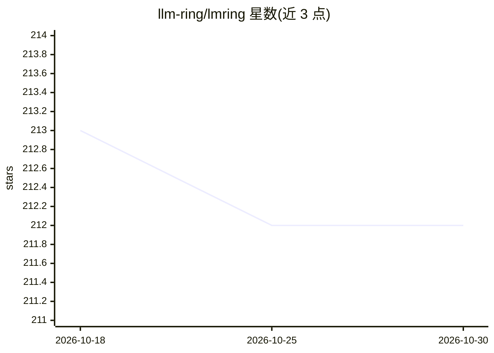

# llm-ring/lmring

⭐ 212 · TypeScript · Apache-2.0 · 推送 2026-10-29 · [GitHub](https://github.com/llm-ring/lmring) · [官网](https://lmring.com) · 组织维护 · 中文 README

**可自托管的 LLM 对比竞技场：并排比较多模型并投票排名**

基于 Next.js/React 的开源自托管 LLM 竞技场应用：Arena 模式下并排比较 2-5 个模型的实时流式回答，支持投票产生排行榜（表格/柱状图/散点图），可保存与分享对比历史。支持 50+ 模型提供商及任意 OpenAI 兼容端点，覆盖文本、图像、视频多模态输入，另提供跨 7 家提供商的 AI 视频生成对比。认证支持 GitHub/Google/Linux.do OAuth 与邮件 OTP，可 Docker Compose 或 Vercel/Cloudflare 部署，需 PostgreSQL。

## 筛选速览

| 维度 | 判定 | 备注 |
|---|---|---|
| AI 角色 | `ai-ecosystem` | LLM/agent 周边工具 |
| 许可风险 | `permissive` | Apache-2.0 |
| 部署形态 | `self-host` | docker 或自建部署 |
| 模型依赖 | — | README 未给出锁定关系 |
| 硬件要求 | — | 无带数字的原话,不猜 |
| 安装摩擦 | `low` | 无编译、无系统依赖或容器化 |
| 成熟度 | — | 结构信号不足 |

## 能力要点

- Arena 模式实时流式并排比较 2-5 个模型
- 众包投票生成排行榜（表格/柱状图/散点图）
- 50+ 提供商支持及任意 OpenAI 兼容端点
- 跨 7 家提供商的 AI 视频生成对比

## 适用场景

- 并排比较多个 LLM 的回答并投票选出偏好
- 搭建自有数据主权的模型评测竞技场
- 查看社区投票形成的模型排行榜
- 对比不同提供商的 AI 视频生成效果

## 场景标签

`模型评测` `视频生成` `多模态` · 领域:评测与运维

## 证据(README 行号)

> L18: - **Arena Mode** — Compare 2-5 AI models simultaneously with real-time streaming
> L20: - **Leaderboard** — Ranked models with table, bar chart, and scatter plot views
> L21: - **Voting System** — Crowdsource model quality evaluations
> L26: - **Self-Hosted** — Full data ownership on your own infrastructure

## 星数曲线

2026-10-18 213 → 2026-10-30 212（-1）

---
*卡片 v1 · prompt 1.4 · 生成 2026-10-22 · 置信度 high · 依据 README sha `e8852d948401` · [字段定义](../../DATASET.md)*
