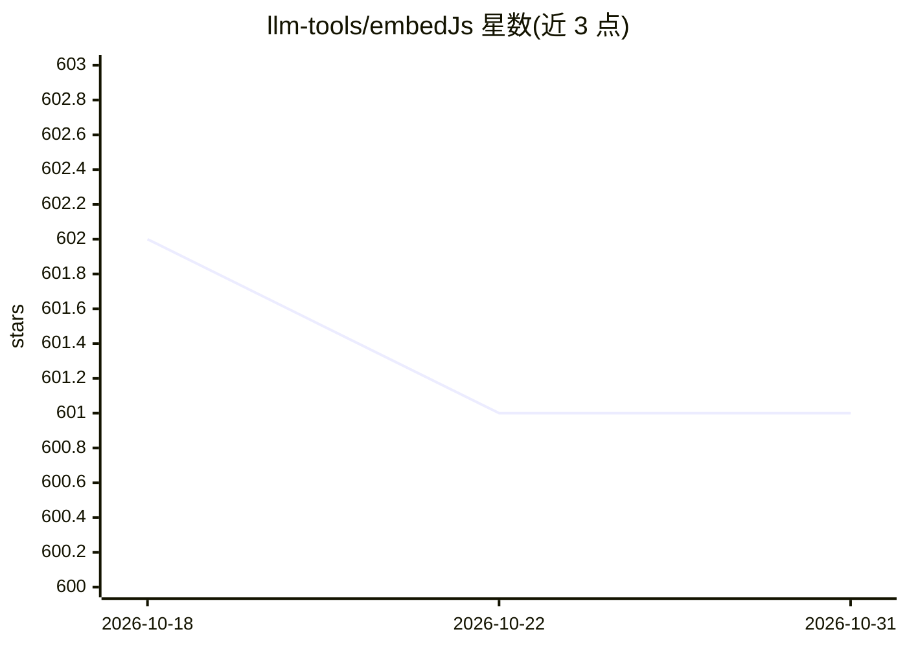

# llm-tools/embedJs

⭐ 601 · TypeScript · Apache-2.0 · 推送 2026-06-26 · [GitHub](https://github.com/llm-tools/embedJs) · [官网](https://llm-tools.mintlify.app/get-started/introduction) · 组织维护

**Node.js 的 RAG/LLM 应用构建框架**

开源 Node.js 框架，用于构建检索增强生成（RAG）与 LLM 应用。工作机制：将用户数据切分为分块，生成对应嵌入向量并存入向量数据库以优化检索；在此之上支持提取上下文信息、问答与交互式对话，实现基于个人数据的定制化 LLM 响应。提供文档站（入门指南、支持的数据类型、示例等），通过 GitHub 仓库以 npm 包形式分发，接受社区贡献。

## 筛选速览

| 维度 | 判定 | 备注 |
|---|---|---|
| AI 角色 | `ai-ecosystem` | LLM/agent 周边工具 |
| 许可风险 | `permissive` | Apache-2.0 |
| 部署形态 | `None` |  |
| 模型依赖 | — | README 未给出锁定关系 |
| 硬件要求 | — | 无带数字的原话,不猜 |
| 安装摩擦 | `low` | 无编译、无系统依赖或容器化 |
| 成熟度 | — | 结构信号不足 |

## 能力要点

- 数据切分、嵌入生成与向量数据库存储的 RAG 流水线
- 支持基于自有数据的上下文提取、精准问答与交互式对话
- 以 Node.js/npm 生态提供，附完整文档与示例

## 适用场景

- 用 Node.js 在自己的数据上搭建 RAG 问答应用
- 为 LLM 应用添加个性化数据检索与对话能力

## 场景标签

`RAG` · 领域:知识与检索

## 证据(README 行号)

> L10: EmbedJs is an Open Source Framework for personalizing LLM responses. An ultimate toolkit for building powerful Retr
> L12: It segments data into manageable chunks, generates relevant embeddings, and stores them in a vector database for op

## 星数曲线

2026-10-18 602 → 2026-10-31 601（-1）

---
*卡片 v1 · prompt 1.4 · 生成 2026-10-21 · 置信度 mid · 依据 README sha `cd3ac3380aaa` · [字段定义](../../DATASET.md)*
