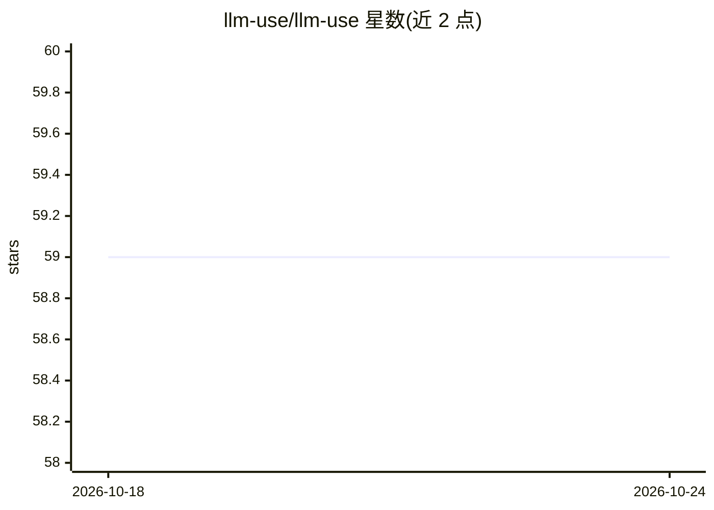

# llm-use/llm-use

⭐ 59 · Python · MIT · 推送 2026-02-07 · [GitHub](https://github.com/llm-use/llm-use) · 组织维护

**面向 agent 工作流的多供应商 LLM 编排工具包：planner+workers+synthesis**

Python 编排工具包，运行“规划器+工作者+综合”流程：编排器拆解任务并委托给更便宜或本地的工作者模型，支持 Anthropic/OpenAI/Ollama/llama.cpp 多供应商混用与并行执行（--max-workers）。含可选路由器（便宜模型判定单发/编排，失败回退启发式；另含基于余弦相似度的学习式路由，存于本地 sqlite）。每次运行记录成本拆分，会话日志存于 ~/.llm-use/sessions；支持带缓存的网页抓取、经 PolyMCP 的 MCP 服务器与 TUI 聊天。以 CLI 与 Python 包（pip install -e .）提供，MIT 许可。

## 筛选速览

| 维度 | 判定 | 备注 |
|---|---|---|
| AI 角色 | `ai-ecosystem` | LLM/agent 周边工具 |
| 许可风险 | `permissive` | MIT |
| 部署形态 | `library` | 以包/库形式分发 |
| 模型依赖 | local-ok | 支持本地模型 |
| 硬件要求 | — | 无带数字的原话,不猜 |
| 安装摩擦 | `low` | 无编译、无系统依赖或容器化 |
| 成熟度 | — | 结构信号不足 |

## 能力要点

- planner+workers+synthesis 跨 Anthropic/OpenAI/Ollama/llama.cpp 编排，可并行多 worker
- 可选 LLM 路由器判定单发/编排，失败回退启发式路由，另有学习式路由（余弦相似度）
- 每次运行的按供应商计价成本统计与会话日志本地存储
- 带缓存的网页抓取、PolyMCP MCP 服务器与 TUI 聊天模式

## 适用场景

- 用云端强模型做编排、本地或便宜模型做执行的多源研究汇总
- 纯 Ollama 本地离线跑隐私敏感的文档分析流水线
- 通过路由器在简单任务上跳过编排以降低调用成本

## 场景标签

`Agent 框架` · 领域:Agent 开发

## 证据(README 行号)

> L7: Universal LLM orchestrator for running a “planner + workers + synthesis” flow across multiple providers (Anthropic, 
> L10: - Provider‑agnostic: mix cloud and local models.

## 星数曲线

2026-10-18 59 → 2026-10-24 59（+0）

---
*卡片 v1 · prompt 1.4 · 生成 2026-10-24 · 置信度 high · 依据 README sha `f3b8a41ca3a2` · [字段定义](../../DATASET.md)*
