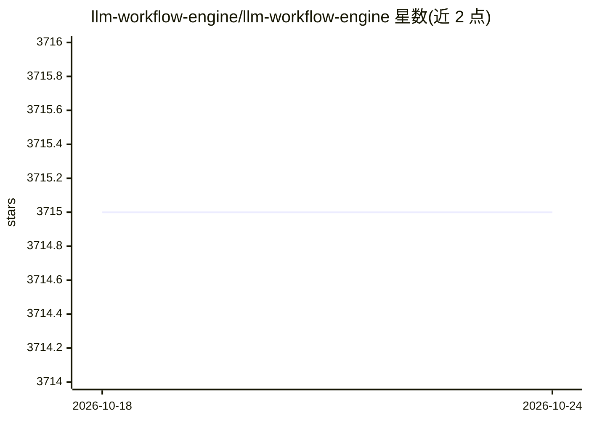

# llm-workflow-engine/llm-workflow-engine

⭐ 3,714 · Python · MIT · 推送 2026-10-23 · [GitHub](https://github.com/llm-workflow-engine/llm-workflow-engine) · 组织维护

**面向 LLM 的命令行工具与工作流管理器**

LLM Workflow Engine（LWE）是从 ChatGPT Wrapper 项目延续而来的 Power CLI 与工作流管理器：可在终端中调用并交互 ChatGPT/GPT4，支持 OpenAI 官方 ChatGPT API 端点，并通过 provider 插件接入 GPT-3、Cohere、Huggingface 等其他 LLM。提供插件架构扩展功能、工具调用（限支持的 provider）、经 Ansible Playbook 将 LLM 调用嵌入更大工作流、实验性 Docker 镜像以及 Python 库形式。采用 MIT 许可证。

## 筛选速览

| 维度 | 判定 | 备注 |
|---|---|---|
| AI 角色 | `ai-ecosystem` | LLM/agent 周边工具 |
| 许可风险 | `permissive` | MIT |
| 部署形态 | `None` |  |
| 模型依赖 | — | README 未给出锁定关系 |
| 硬件要求 | — | 无带数字的原话,不猜 |
| 安装摩擦 | `low` | 无编译、无系统依赖或容器化 |
| 成熟度 | `idea` | |

## 能力要点

- 在终端（Shell）中调用并交互 ChatGPT/GPT4
- 支持 OpenAI 官方 ChatGPT API 端点
- provider 插件架构接入多种 LLM（GPT-3、Cohere、Huggingface 等）
- 经 Ansible Playbook 将 LLM 调用整合进工作流，并提供 Python 库

## 适用场景

- 在命令行中直接与 ChatGPT/GPT4 交互
- 通过插件接入不同 LLM provider 并扩展功能
- 用 Ansible Playbook 把 LLM 调用编排进自动化工作流
- 在 Python 脚本中以库形式调用 ChatGPT/GPT4

## 场景标签

`工作流自动化` `聊天机器人` `AI 助手` · 领域:效率与自动化

## 证据(README 行号)

> L8:  LLM Workflow Engine (LWE) is a Power CLI and Workflow manager for LLMs.
> L49: 🗣 **Supports multiple LLM providers**. Provider plugins allow interacting with other LLMs (GPT-3, Cohere, Huggingfa

## 星数曲线

2026-10-18 3,715 → 2026-10-24 3,715（+0）

---
*卡片 v1 · prompt 1.4 · 生成 2026-10-20 · 置信度 high · 依据 README sha `279ca8f6d3f1` · [字段定义](../../DATASET.md)*
