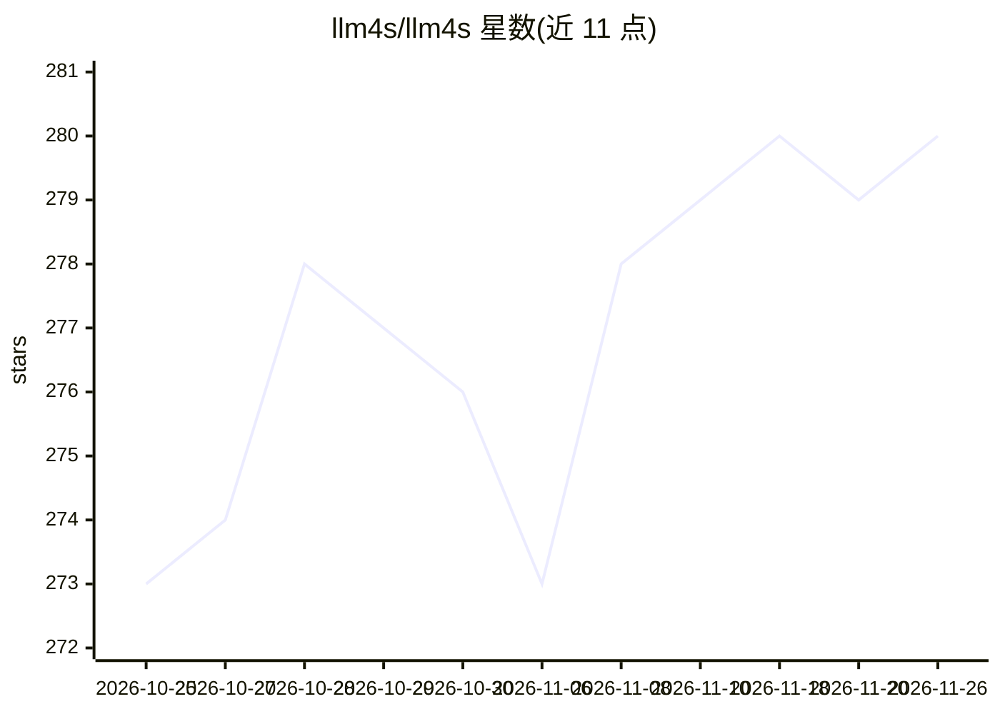

# llm4s/llm4s

⭐ 280 · Scala · MIT · 推送 2026-11-25 · [GitHub](https://github.com/llm4s/llm4s) · 组织维护

**Scala/JVM 的 LLM 应用开发框架：统一接入 18 家聊天服务商**

面向 Scala 3 / JDK 21 的 LLM 应用开发框架，发布于 Maven Central（v1.0.0 起 7 个冻结模块按语义化版本维护，MiMa 检查兼容性）。提供多服务商客户端、Agent 与工具调用、RAG 与向量存储、记忆、guardrails、追踪与指标、工作区隔离、MCP 支持、图像与语音 API；自 0.5.0 起按模块拆分，服务商经 SPI 注册，核心模块不含任何服务商客户端。另有 cookbook 示例（无需 API key 即可运行）与 doctor 配置自检 CLI。

## 筛选速览

| 维度 | 判定 | 备注 |
|---|---|---|
| AI 角色 | `ai-ecosystem` | LLM/agent 周边工具 |
| 许可风险 | `permissive` | MIT |
| 部署形态 | `None` |  |
| 模型依赖 | local-ok | 支持本地模型 |
| 硬件要求 | — | 无带数字的原话,不猜 |
| 安装摩擦 | `medium` | 含编译或系统依赖之一 |
| 成熟度 | — | 结构信号不足 |

## 能力要点

- 一个 API 后接 18 家聊天服务商，含本地 Ollama 与 JVM 内运行的 Jlama
- Agent 框架、RAG（含 RAGAS 评估）、guardrails、MCP 支持与可观测性模块
- 7 个冻结模块在 1.x 内保证源码与二进制兼容，由 MiMa 检查
- 提供 Java/Kotlin/Spring/Gradle 互操作与 doctor 一键配置自检

## 适用场景

- 在 Scala/JVM 企业系统中构建 LLM 应用与多 Agent 工作流
- 通过统一配置切换云端服务商或本地 Ollama 模型
- 为 LLM 应用接入追踪、指标与成本追踪等可观测性能力

## 场景标签

`Agent 框架` `RAG` `LLM 可观测性` · 领域:Agent 开发

## 证据(README 行号)

> L53: LLM4S provides a simple, robust, and scalable framework for building LLM applications in Scala. While most LLM work
> L61: The framework already provides multi-provider clients, agents and tool calling, RAG and vector stores, memory, guar
> L63: Since 0.5.0, llm4s ships as separate modules. RAG, knowledge graph, memory, MCP, shared media types, image, and spe

## 星数曲线

2026-10-25 273 → 2026-11-26 280（+7）

---
*卡片 v1 · prompt 1.4 · 生成 2026-11-26 · 置信度 high · 依据 README sha `da26075ac2f5` · [字段定义](../../DATASET.md)*
