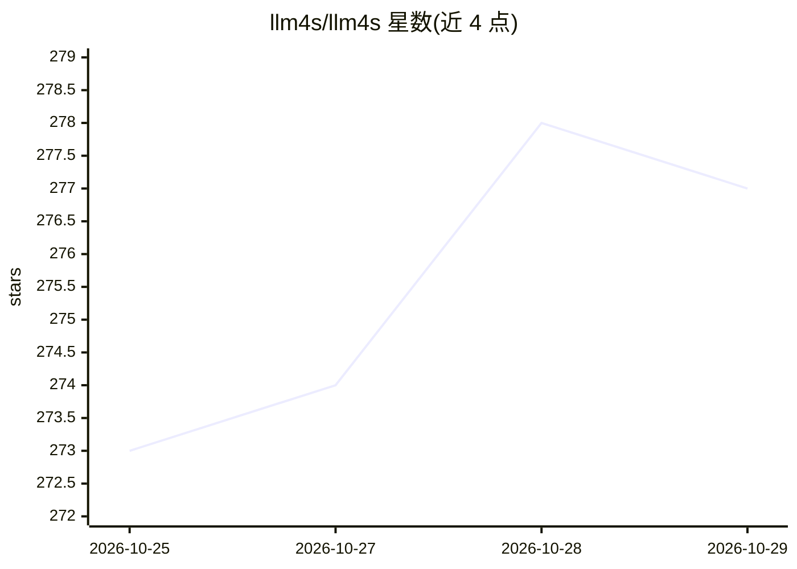

# llm4s/llm4s

⭐ 277 · Scala · MIT · 推送 2026-10-25 · [GitHub](https://github.com/llm4s/llm4s) · 组织维护

**面向 Scala/JVM 开发者的 LLM 应用与 Agent 开发框架**

用 Scala 3 构建类型安全 LLM 应用的框架：提供多供应商客户端（OpenAI、Anthropic、Gemini、Ollama 等，各以独立模块通过 SPI 注册）、Agent 与工具调用、RAG 与向量存储、记忆、护栏、MCP 支持、追踪与指标（Langfuse/Prometheus 模块）以及图像语音 API。0.5.1 起拆分为多个模块发布于 Maven Central，要求 Scala 3.7.1 与 JDK 21；项目处于 pre-1.0 阶段，API 仍在稳定化。含 cookbook 示例、doctor 配置检查与容器化运行演示。

## 筛选速览

| 维度 | 判定 | 备注 |
|---|---|---|
| AI 角色 | `ai-ecosystem` | LLM/agent 周边工具 |
| 许可风险 | `permissive` | MIT |
| 部署形态 | `None` |  |
| 模型依赖 | local-ok | 支持本地模型 |
| 硬件要求 | — | 无带数字的原话,不猜 |
| 安装摩擦 | `medium` | 含编译或系统依赖之一 |
| 成熟度 | `idea` | |

## 能力要点

- 多供应商客户端模块（OpenAI/Anthropic/Gemini/Ollama/DeepSeek 等，SPI 注册）
- Agent 框架、MCP 支持、RAG 与向量存储、护栏与记忆
- 可观测性模块：Langfuse 追踪、Prometheus 指标、成本追踪
- 无需 API key 的 cookbook 可运行示例与配置 doctor 检查

## 适用场景

- 在 Scala/JVM 项目中接入多家 LLM 供应商
- 构建单/多 Agent 工作流与工具调用
- 实现带护栏、RAG 与追踪的 LLM 应用

## 场景标签

`Agent 框架` `RAG` `模型网关` `LLM 可观测性` · 领域:Agent 开发

## 证据(README 行号)

> L61: The framework already provides multi-provider clients, agents and tool calling, RAG and vector stores, memory, guar
> L63: Since 0.5.0, llm4s ships as separate modules. RAG, knowledge graph, memory, MCP, shared media types, image, and spe
> L53: LLM4S provides a simple, robust, and scalable framework for building LLM applications in Scala. While most LLM work

## 星数曲线

2026-10-25 273 → 2026-10-29 277（+4）

---
*卡片 v1 · prompt 1.4 · 生成 2026-10-24 · 置信度 high · 依据 README sha `683d9a16e87d` · [字段定义](../../DATASET.md)*
