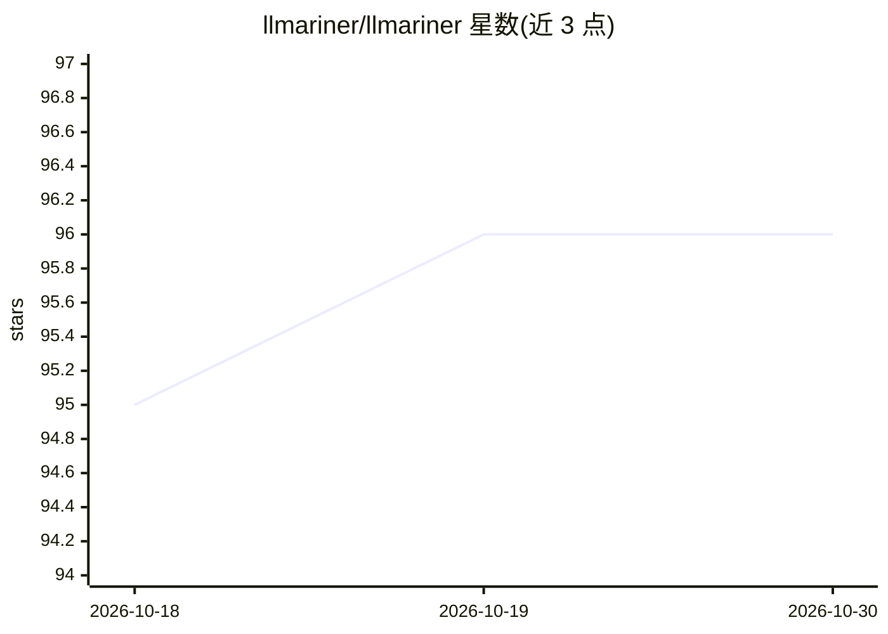

# llmariner/llmariner

⭐ 96 · Go · Apache-2.0 · 推送 2026-05-14 · [GitHub](https://github.com/llmariner/llmariner) · [官网](https://llmariner.ai) · 组织维护

**Kubernetes 上的生成式 AI 工作负载管理平台，OpenAI 兼容 API**

基于 Kubernetes 的开源生成式 AI 平台，用于管理训练与推理工作负载，暴露 OpenAI 兼容 API 供客户端调用。架构分为 control-plane（提供 API、管理整体状态）与一个或多个 worker-plane（利用 GPU 等计算资源处理任务），两者可部署于单集群，也可跨多集群利用 GPU 资源。支持与 Open WebUI、Continue、Weights & Biases 等工具集成，提供 Helm chart、CLI、部署脚本与教程。

## 筛选速览

| 维度 | 判定 | 备注 |
|---|---|---|
| AI 角色 | `ai-ecosystem` | LLM/agent 周边工具 |
| 许可风险 | `permissive` | Apache-2.0 |
| 部署形态 | `library` | 以包/库形式分发 |
| 模型依赖 | — | README 未给出锁定关系 |
| 硬件要求 | — | 无带数字的原话,不猜 |
| 安装摩擦 | `low` | 无编译、无系统依赖或容器化 |
| 成熟度 | — | 结构信号不足 |

## 能力要点

- OpenAI 兼容 API 的 control-plane 与 GPU worker-plane 架构
- 支持跨多集群利用 GPU 资源
- 管理生成式 AI 的训练与推理工作负载（含 fine-tuning）
- 提供 Helm chart、CLI、provision 脚本与集成示例

## 适用场景

- 在自己的 Kubernetes 集群上搭建 OpenAI 兼容的 LLM API 服务
- 跨多个集群调度 GPU 资源运行训练与推理任务
- 通过 Open WebUI / Continue 等工具接入自托管模型服务

## 场景标签

`微调` `推理引擎` · 领域:训练与推理

## 证据(README 行号)

> L6: LLMariner (= LLM + Mariner) is an extensible open source platform to simplify the management of generative AI worklo
> L12: LLMariner consists of a control-plane and one or more worker-planes. Both components can operate within a single cl
> L16:  <dd>Expose the OpenAI-compatible APIs and manage the overall state of LLMariner and receive a request from the cli

## 星数曲线

2026-10-18 95 → 2026-10-30 96（+1）

---
*卡片 v1 · prompt 1.4 · 生成 2026-10-23 · 置信度 high · 依据 README sha `d1d7846975aa` · [字段定义](../../DATASET.md)*
