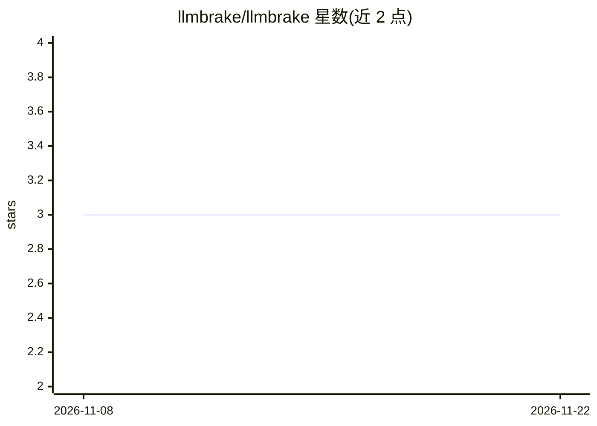

# llmbrake/llmbrake

⭐ 3 · Python · MIT · 推送 2026-11-09 · [GitHub](https://github.com/llmbrake/llmbrake) · [官网](https://llmbrake.com) · 个人维护

**给 AI 应用按客户加用量预算，超限自动降级或拦截**

TypeScript 库，包装 OpenAI 兼容的 chat.completions.create 调用：按返回的 token 用量以美元计价，按客户累计月度花费。接近预算时按 downgradeMap 换用更便宜模型，达到预算时在请求到达提供方前抛出 BudgetExceededError。不读取或存储提示词与补全内容，仅记录客户 ID、模型、token 数与成本等元数据；零运行时依赖，支持流式，另提供 Python 移植版与可选的云端托管存储与仪表盘（付费层）。

## 筛选速览

| 维度 | 判定 | 备注 |
|---|---|---|
| AI 角色 | `ai-ecosystem` | LLM/agent 周边工具 |
| 许可风险 | `permissive` | MIT |
| 部署形态 | `library` | 以包/库形式分发 |
| 模型依赖 | — | README 未给出锁定关系 |
| 硬件要求 | — | 无带数字的原话,不猜 |
| 安装摩擦 | `low` | 无编译、无系统依赖或容器化 |
| 成熟度 | `idea` | |

## 能力要点

- 按客户月度美元预算拦截/降级，预算前抛类型化错误且不调用提供方
- 接近预算阈值时按 downgradeMap 自动换用更便宜模型
- 支持任意 OpenAI 兼容端点（OpenRouter、本地网关等），自配价格表
- 可插拔 UsageStore（内存/Redis/云端托管），支持 failOpen/failClosed

## 适用场景

- 给 SaaS 的每个客户设置 AI 调用月度费用上限
- 预算临近时自动把用户切换到更便宜的模型
- 多实例部署下用 Redis/托管存储共享用量计数

## 场景标签

`模型网关` · 领域:Agent 开发

## 证据(README 行号)

> L9: `llmbrake` is a small TypeScript library that wraps your OpenAI-compatible `chat.completions.create` call. It prices
> L11: - **Not a proxy.** It runs inside your app and calls your provider directly with your own keys.
> L64: Any `create(params)` function that accepts `{ model, ... }` and returns `{ model, usage: { prompt_tokens, completio

## 星数曲线

2026-11-08 3 → 2026-11-22 3（+0）

---
*卡片 v1 · prompt 1.4 · 生成 2026-11-21 · 置信度 high · 依据 README sha `8a4cc194fe8d` · [字段定义](../../DATASET.md)*
