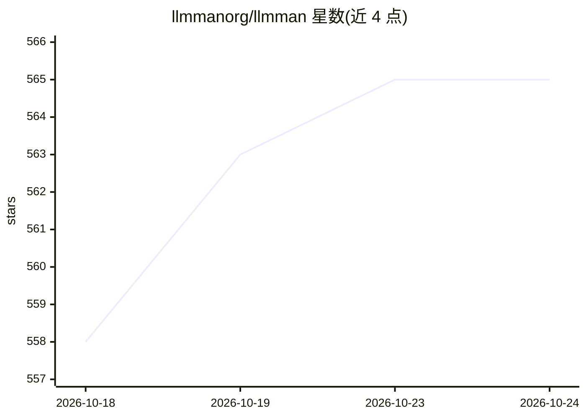

# llmmanorg/llmman

⭐ 565 · Rust · Apache-2.0 · 推送 2026-10-23 · [GitHub](https://github.com/llmmanorg/llmman) · [官网](https://llmmanorg.github.io/) · 组织维护

**本地/托管模型上运行各类 AI agent 的 CLI 与推理服务**

命令行工具加守护进程：`launch` 一条命令为 Claude Code、Codex、OpenCode 等 agent 启动本地推理服务并注入环境变量；`serve` 在 127.0.0.1:17434 提供 Ollama/OpenAI/Anthropic 兼容 API。模型以 OCI 镜像形式存储于任意 OCI 注册表（Docker Hub/GHCR/Hugging Face 等），磁盘格式为未修改的 GGUF/safetensors，由上游 llama.cpp、vllm、sglang、mlx-lm 提供推理。支持注册表间一步转移、cosign 签名验证、多机硬件聚合。安装支持 curl 脚本、Homebrew、Scoop、Cargo 与 Docker。

## 筛选速览

| 维度 | 判定 | 备注 |
|---|---|---|
| AI 角色 | `ai-ecosystem` | LLM/agent 周边工具 |
| 许可风险 | `permissive` | Apache-2.0 |
| 部署形态 | `desktop` | 安装包/桌面程序 |
| 模型依赖 | local-ok | 支持本地模型 |
| 硬件要求 | — | 无带数字的原话,不猜 |
| 安装摩擦 | `low` | 无编译、无系统依赖或容器化 |
| 成熟度 | — | 结构信号不足 |

## 能力要点

- 模型打包为标准 OCI 制品，可存于任意 OCI 注册表并 cosign 签名验证
- 一个端点兼容 Ollama/OpenAI/Anthropic API，现有客户端无需改动
- 一条命令将 Claude Code/Codex/OpenCode 等 agent 指向本地或托管模型
- 多个 llmman serve 守护进程可聚合为单一端点共享硬件

## 适用场景

- 在本地模型上运行 Claude Code 等 agent CLI
- 用现有容器注册表基础设施分发、镜像和签名模型
- 多台机器组成一个推理端点，按需调度模型加载
- 通过 transfer 将 Hugging Face 模型直接转入私有注册表（离线/合规场景）

## 场景标签

`推理引擎` · 领域:训练与推理

## 证据(README 行号)

> L14: That starts a local inference server, fetches the tested `llama.cpp` release for
> L105: llmman serve                          # an Ollama/OpenAI/Anthropic-compatible endpoint
> L288: Point an integration at a model in one step. `llmman launch` starts `serve`

## 星数曲线

2026-10-18 558 → 2026-10-24 565（+7）

---
*卡片 v1 · prompt 1.4 · 生成 2026-10-22 · 置信度 mid · 依据 README sha `57cf7d5bfa18` · [字段定义](../../DATASET.md)*
