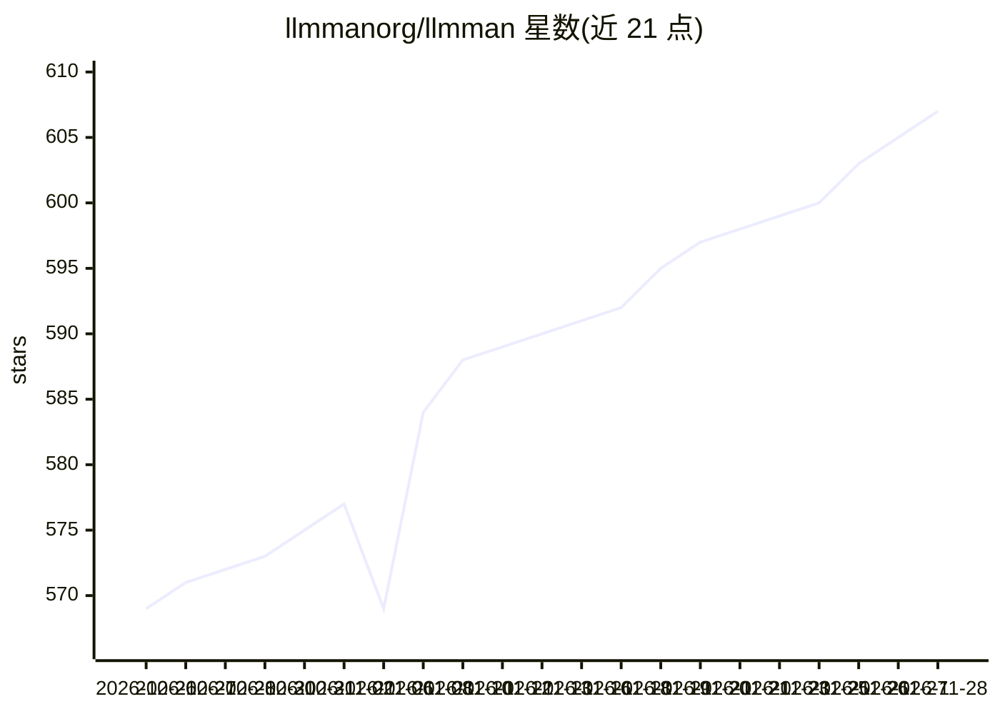

# llmmanorg/llmman

⭐ 607 · Rust · Apache-2.0 · 推送 2026-11-27 · [GitHub](https://github.com/llmmanorg/llmman) · [官网](https://llmmanorg.github.io/) · 组织维护

**把任意 agent 指向任意模型：模型以 OCI 镜像存储与分发**

用 Rust 编写的 CLI/守护进程工具：将模型打包为标准 OCI 工件存入任意容器镜像仓库，一条命令拉起本地推理服务（默认上游 llama.cpp，也支持 vllm/sglang/mlx-lm）并在其上启动 Claude Code、Codex、OpenCode 等 agent；提供 Ollama/OpenAI/Anthropic 兼容端点、跨仓库一键 transfer、cosign 格式签名校验、多机 serve 聚合、Kubernetes CSI 挂载、桌面应用与 Web UI。支持 hosted provider 与本地模型混用。源码构建需 Go 与 Rust。

## 筛选速览

| 维度 | 判定 | 备注 |
|---|---|---|
| AI 角色 | `ai-ecosystem` | LLM/agent 周边工具 |
| 许可风险 | `permissive` | Apache-2.0 |
| 部署形态 | `desktop` | 安装包/桌面程序 |
| 模型依赖 | local-ok | 支持本地模型 |
| 硬件要求 | — | 无带数字的原话,不猜 |
| 安装摩擦 | `low` | 无编译、无系统依赖或容器化 |
| 成熟度 | — | 结构信号不足 |

## 能力要点

- 模型以 OCI Image Layout 存储，可 push 到 Docker Hub/GHCR/quay/Harbor/自建仓库
- 一条命令拉起本地推理服务并启动 agent（llmman launch claude --model ...）
- 提供 Ollama、OpenAI、Anthropic 三种兼容 API 端点
- cosign 签名与 pull 时信任策略；llmman-csi 将模型以只读卷挂进 Pod

## 适用场景

- 在本地模型上运行 Claude Code/Codex 等 agent 而不改客户端配置
- 把 Hugging Face 模型直接转入自有镜像仓库用于离线/合规环境
- 用容器镜像仓库已有的镜像、签名与访问控制体系管理模型
- 把多台机器的 serve 守护进程聚合为一个推理端点

## 场景标签

`推理引擎` · 领域:训练与推理

## 证据(README 行号)

> L5:  Run any agent on any model.
> L34: - **Registry agnostic.** `llmman run qwen3.8` pulls straight from Docker
> L273: One endpoint on `127.0.0.1:17434` that speaks Ollama, OpenAI and Anthropic:

## 星数曲线

2026-10-26 569 → 2026-11-28 607（+38）

---
*卡片 v1 · prompt 1.4 · 生成 2026-11-28 · 置信度 mid · 依据 README sha `97c6bb5b7361` · [字段定义](../../DATASET.md)*
