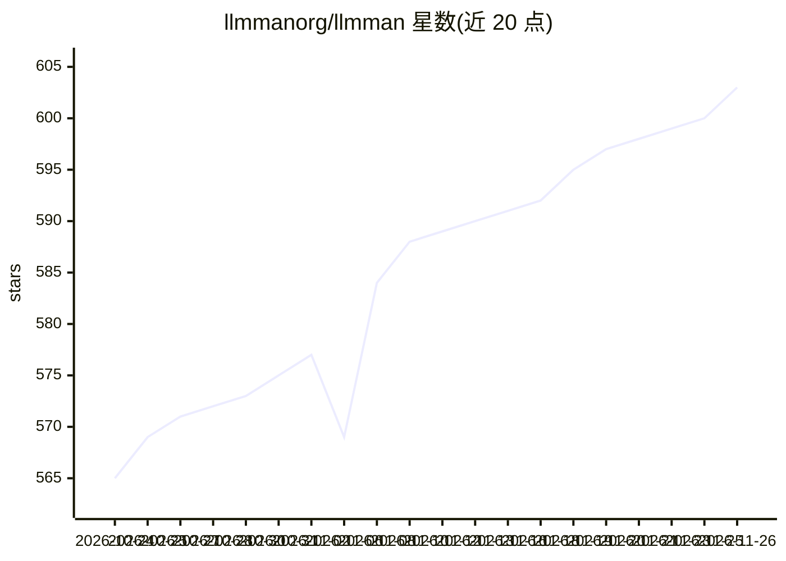

# llmmanorg/llmman

⭐ 603 · Rust · Apache-2.0 · 推送 2026-11-25 · [GitHub](https://github.com/llmmanorg/llmman) · [官网](https://llmmanorg.github.io/) · 个人维护

**以 OCI 镜像分发模型并一键驱动各类 coding agent 的工具**

llmman 将模型打包为标准 OCI 制品存放在任意容器镜像仓库（Docker Hub、GHCR、quay、自建），提供 launch/run/serve/pull/transfer/verify 等命令：启动本地推理服务后运行 Claude Code、Codex、OpenCode 等 agent，或直接对话、生成图像/视频/音频。serve 暴露 Ollama、OpenAI、Anthropic 三种兼容 API，底层调用上游 llama.cpp、vllm、sglang、mlx-lm。面向需要本地或私有化模型供给的开发者与受合规约束的环境；源码构建需 Go 1.27.3+ 与 Rust。

## 筛选速览

| 维度 | 判定 | 备注 |
|---|---|---|
| AI 角色 | `ai-ecosystem` | LLM/agent 周边工具 |
| 许可风险 | `permissive` | Apache-2.0 |
| 部署形态 | `desktop` | 安装包/桌面程序 |
| 模型依赖 | local-ok | 支持本地模型 |
| 硬件要求 | — | 无带数字的原话,不猜 |
| 安装摩擦 | `low` | 无编译、无系统依赖或容器化 |
| 成熟度 | — | 结构信号不足 |

## 能力要点

- 模型以标准 OCI 制品存储，支持任意兼容镜像仓库直拉直推
- 一条命令启动本地推理并驱动 Claude Code/Codex/OpenCode 等 agent
- serve 提供 Ollama/OpenAI/Anthropic 兼容端点，现有客户端无需改动
- 多机 serve 守护进程聚合为单一端点，按模型加载情况调度请求

## 适用场景

- 在本地 GPU 上用自有模型运行 coding agent
- 把模型从 Hugging Face 直迁到自建镜像仓库（含离线/内网场景）
- 为团队提供统一的本地模型推理端点，复用现有 OpenAI/Ollama 客户端
- 用 cosign 签名与 pull 时信任策略控制模型供应链

## 场景标签

`编码 Agent` `推理引擎` · 领域:编码与开发

## 证据(README 行号)

> L5:  Run any agent on any model.
> L14: That starts a local inference server, fetches the tested `llama.cpp` release for
> L262: One endpoint on `127.0.0.1:17434` that speaks Ollama, OpenAI and Anthropic:

## 星数曲线

2026-10-24 565 → 2026-11-26 603（+38）

---
*卡片 v1 · prompt 1.4 · 生成 2026-11-25 · 置信度 mid · 依据 README sha `b47e0544ab63` · [字段定义](../../DATASET.md)*
