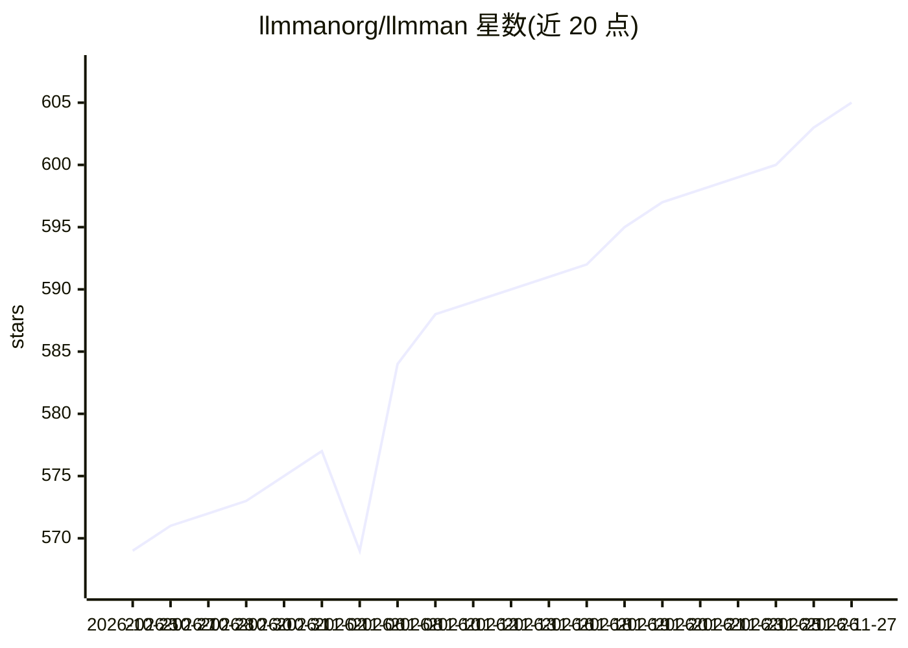

# llmmanorg/llmman

⭐ 605 · Rust · Apache-2.0 · 推送 2026-11-26 · [GitHub](https://github.com/llmmanorg/llmman) · [官网](https://llmmanorg.github.io/) · 个人维护

**把任意 agent 指向任意模型的本地推理服务器与 OCI 模型管理器**

一个以 CLI 形式提供的本地推理服务器与模型管理工具：用 launch 命令把 Claude Code、Codex、OpenCode 等 agent 指向本地或托管模型，模型以标准 OCI 镜像形式存储于任意容器仓库，支持 pull/transfer/push/verify 与 cosign 签名校验。serve 提供兼容 Ollama、OpenAI、Anthropic 的端点，后端使用上游 llama.cpp、vllm、sglang、mlx-lm，多个 serve 守护进程可聚合硬件。提供脚本、brew、scoop、cargo、容器等安装方式。

## 筛选速览

| 维度 | 判定 | 备注 |
|---|---|---|
| AI 角色 | `ai-ecosystem` | LLM/agent 周边工具 |
| 许可风险 | `permissive` | Apache-2.0 |
| 部署形态 | `desktop` | 安装包/桌面程序 |
| 模型依赖 | local-ok | 支持本地模型 |
| 硬件要求 | — | 无带数字的原话,不猜 |
| 安装摩擦 | `low` | 无编译、无系统依赖或容器化 |
| 成熟度 | — | 结构信号不足 |

## 能力要点

- 模型以 OCI 标准格式存储，可在 Docker Hub/GHCR/quay/Harbor 等任意注册表间直接 transfer
- serve 端点同时兼容 Ollama、OpenAI 与 Anthropic API，现有客户端无需修改即可使用
- 支持 llama.cpp、vllm、sglang、mlx-lm 作为推理后端，服务未修改的 GGUF 与 safetensors
- 多台机器的 serve 守护进程可聚合为一个端点，按模型加载情况分发请求

## 适用场景

- 在内网或合规环境用自有注册表分发和签名验证模型
- 一条命令让 Claude Code 等 agent 使用本地运行的模型
- 统一入口在本地模型与 Groq、BaseTen 等托管提供商之间切换
- 把多台机器的 GPU 汇聚成一个推理端点

## 场景标签

`推理引擎` · 领域:训练与推理

## 证据(README 行号)

> L5:  Run any agent on any model.
> L111: llmman serve                          # an Ollama/OpenAI/Anthropic-compatible endpoint
> L262: One endpoint on `127.0.0.1:17434` that speaks Ollama, OpenAI and Anthropic:

## 星数曲线

2026-10-25 569 → 2026-11-27 605（+36）

---
*卡片 v1 · prompt 1.4 · 生成 2026-11-27 · 置信度 mid · 依据 README sha `4a9d86242d45` · [字段定义](../../DATASET.md)*
