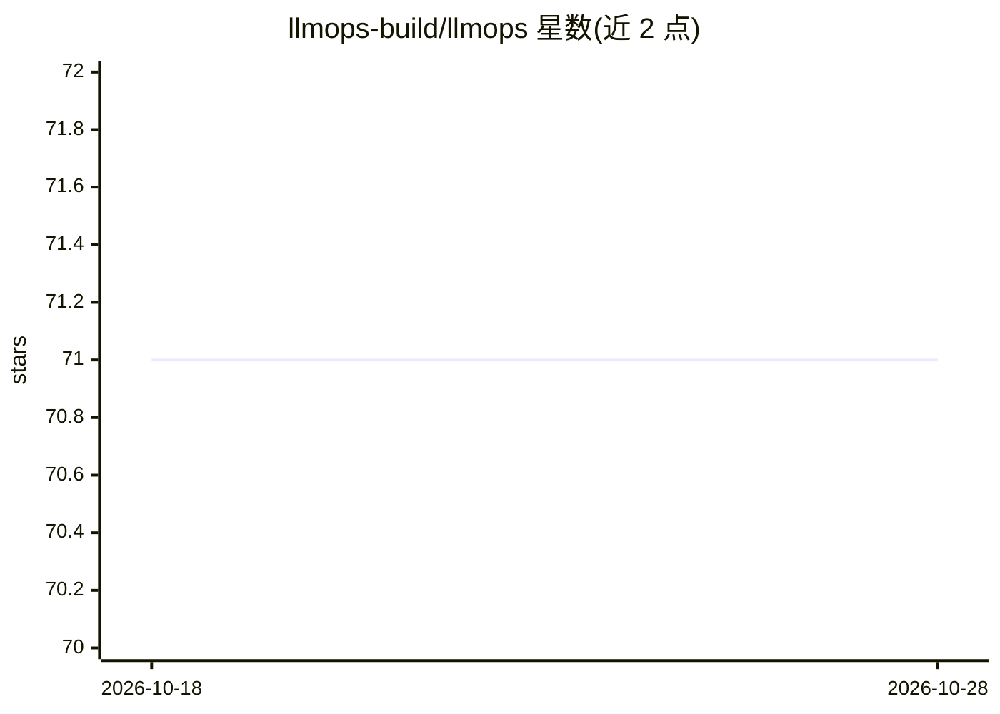

# llmops-build/llmops

⭐ 71 · TypeScript · Apache-2.0 · 推送 2026-08-15 · [GitHub](https://github.com/llmops-build/llmops) · [官网](https://llmops.build) · 组织维护

**TypeScript 应用的可插拔 LLMOps 工具包**

面向 TypeScript 团队的开源 LLMOps 工具包，用于在应用中集成、管理与监控 LLM 提供商。提供统一 Provider 接口（列举 OpenAI、Anthropic、Azure、Bedrock、Mistral 等 70+ 提供商）、兼容 OpenAI SDK 的替换 API（改 base URL 即可）、集中式 prompt 注册与版本管理、请求/响应日志、成本追踪与性能监控。以 npm 包形式分发，可部署到 Railway。

## 筛选速览

| 维度 | 判定 | 备注 |
|---|---|---|
| AI 角色 | `ai-ecosystem` | LLM/agent 周边工具 |
| 许可风险 | `permissive` | Apache-2.0 |
| 部署形态 | `None` |  |
| 模型依赖 | — | README 未给出锁定关系 |
| 硬件要求 | — | 无带数字的原话,不猜 |
| 安装摩擦 | `low` | 无编译、无系统依赖或容器化 |
| 成熟度 | — | 结构信号不足 |

## 能力要点

- 统一接口列举 70+ LLM 提供商（OpenAI/Anthropic/Azure/Bedrock/Mistral 等）
- OpenAI SDK 兼容 API，改 base URL 即接入
- prompt 版本管理与集中注册
- 请求日志、成本追踪与性能监控

## 适用场景

- TypeScript 应用统一接入多家 LLM 提供商
- 对 LLM 调用做日志与成本追踪
- 集中管理 prompt 的版本与发布

## 场景标签

`模型网关` `LLM 可观测性` `提示工程` · 领域:Agent 开发

## 证据(README 行号)

> L23: LLMOps is an open-source, pluggable toolkit designed for TypeScript teams to streamline LLM operations with a focus
> L27: - **Unified Provider Interface**: Support for 70+ LLM providers including OpenAI, Anthropic, Azure, Bedrock, Mistra

## 星数曲线

2026-10-18 71 → 2026-10-28 71（+0）

---
*卡片 v1 · prompt 1.4 · 生成 2026-10-24 · 置信度 mid · 依据 README sha `289d1e695e02` · [字段定义](../../DATASET.md)*
