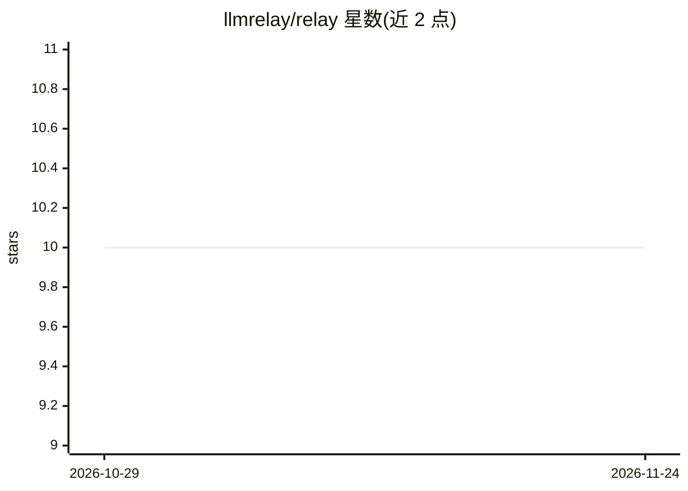

# llmrelay/relay

⭐ 10 · Go · Apache-2.0 · 推送 2026-07-20 · [GitHub](https://github.com/llmrelay/relay) · 组织维护

**自托管 LLM 网关与模型路由：接入 OpenAI/Anthropic 方言，路由到任意提供商**

单个 Go 静态二进制的自托管 LLM 网关与模型路由器：入站同时接受 OpenAI 与 Anthropic API 方言并跨译，出站按 BYO key 路由到 OpenAI、Anthropic、Gemini、Groq、DeepSeek 及本地 Ollama 等。路由策略从静态别名（fallback/cheapest/fastest/weighted）到基于难度的 smart tier（默认关闭），内置 eval harness 以 live-judge 评分作为启用门槛；附 SQLite 本地日志、/dashboard、Prometheus /metrics、流式 failover 与熔断。Apache-2.0，零遥测，默认仅监听回环地址。

## 筛选速览

| 维度 | 判定 | 备注 |
|---|---|---|
| AI 角色 | `ai-ecosystem` | LLM/agent 周边工具 |
| 许可风险 | `permissive` | Apache-2.0 |
| 部署形态 | `self-host` | docker 或自建部署 |
| 模型依赖 | local-ok | 支持本地模型 |
| 硬件要求 | — | 无带数字的原话,不猜 |
| 安装摩擦 | `low` | 无编译、无系统依赖或容器化 |
| 成熟度 | — | 结构信号不足 |

## 能力要点

- 入站 OpenAI 与 Anthropic 双方言、完整交叉翻译（含流式与 tools）
- 静态路由四策略 + 重试/密钥池/熔断/首 token 前流式 failover
- 内置 relay eval 评测框架，smart routing 默认关闭且以评测结果为启用门槛
- 本地 SQLite 日志三档隐私、/dashboard、Prometheus /metrics，零遥测

## 适用场景

- 为团队自托管一个统一入口，把 OpenAI SDK 与 Claude Code 的流量路由到多家模型
- 按成本/速度/权重策略配置别名链并在故障时自动切换
- 用 relay eval 与 compare 在自己的流量上比较各路由策略与模型的成本和质量
- 需要无遥测、数据不出本地的 LLM 代理

## 场景标签

`模型网关` · 领域:Agent 开发

## 证据(README 行号)

> L3: Self-hosted LLM gateway + model router. One static Go binary that speaks both
> L6: learned smart tier — gated by an eval harness that ships in the box. Zero

## 星数曲线

2026-10-29 10 → 2026-11-24 10（+0）

---
*卡片 v1 · prompt 1.4 · 生成 2026-11-19 · 置信度 high · 依据 README sha `d0665e06985d` · [字段定义](../../DATASET.md)*
