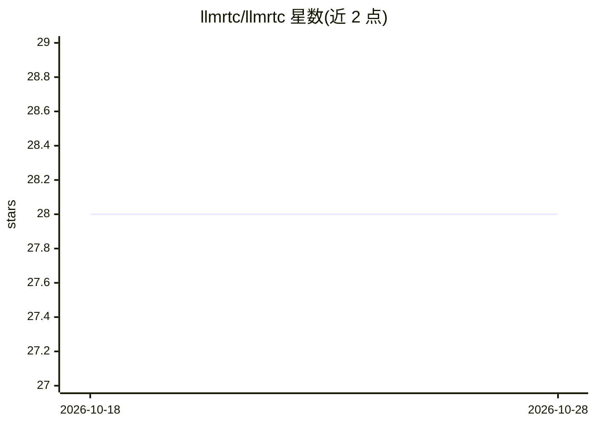

# llmrtc/llmrtc

⭐ 28 · TypeScript · Apache-2.0 · 推送 2026-07-12 · [GitHub](https://github.com/llmrtc/llmrtc) · [官网](https://www.llmrtc.org/) · 组织维护

**构建实时多模态语音/视觉 AI Agent 的 TypeScript SDK**

开源 TypeScript SDK，通过 WebRTC 组合 LLM、STT、TTS 与视觉能力，构建低延迟对话式语音/视觉 Agent。后端以 npm 包提供，含信令服务器与编排器（audio→STT→LLM→TTS 流水线），浏览器端提供 WebRTC 客户端。支持 OpenAI、Anthropic、Gemini、AWS Bedrock、OpenRouter 及 Ollama/LMStudio/Faster Whisper/Piper 等本地模型，具备工具调用、多阶段 Playbook、VAD、打断与自动重连。要求 Node 20+；流式 TTS 需 FFmpeg；原生 WebRTC 模块在无预编译二进制的平台需 C/C++ 构建工具；NAT/防火墙环境建议配置 TURN 服务器。

## 筛选速览

| 维度 | 判定 | 备注 |
|---|---|---|
| AI 角色 | `ai-ecosystem` | LLM/agent 周边工具 |
| 许可风险 | `permissive` | Apache-2.0 |
| 部署形态 | `library` | 以包/库形式分发 |
| 模型依赖 | local-ok | 支持本地模型 |
| 硬件要求 | — | 无带数字的原话,不猜 |
| 安装摩擦 | `high` | 编译与系统依赖俱全 |
| 成熟度 | `idea` | |

## 能力要点

- WebRTC 音频流式传输与服务端 VAD、打断、自动重连
- 多 LLM/STT/TTS 提供商适配，含 Ollama、LMStudio、Faster Whisper、Piper 本地方案
- Playbook 多阶段对话流与提供商无关的 JSON Schema 工具调用
- 实验性实时语音到语音中继模式（OpenAI gpt-realtime、Gemini Live）

## 适用场景

- 开发低延迟网页语音助手或对话 Agent
- 接入摄像头/屏幕捕获构建多模odal 视觉 Agent
- 用本地模型（Ollama/Faster Whisper/Piper）搭建离线语音流水线

## 场景标签

`语音 Agent` `多模态` · 领域:对话与助手

## 证据(README 行号)

> L5:  An Open Source TypeScript SDK for building real-time voice and vision AI Agents.
> L6:  Combines LLM, Speech-to-Text, Text-to-Speech, and vision capabilities over WebRTC for low-latency conversational AI
> L261: The orchestrator manages the conversation flow: audio → STT → LLM → TTS.

## 星数曲线

2026-10-18 28 → 2026-10-28 28（+0）

---
*卡片 v1 · prompt 1.4 · 生成 2026-10-26 · 置信度 high · 依据 README sha `a4f7c9839c7a` · [字段定义](../../DATASET.md)*
