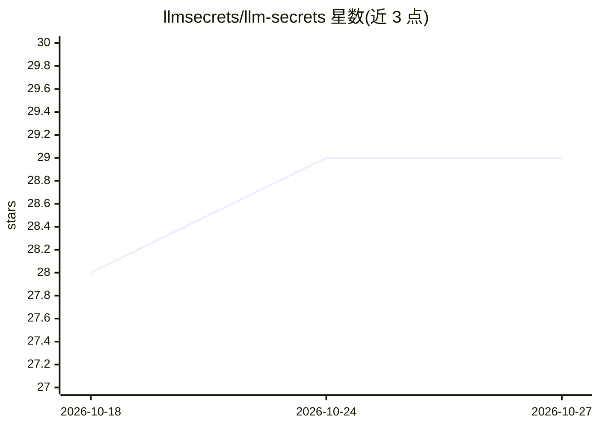

# llmsecrets/llm-secrets

⭐ 29 · Rust · AGPL-3.0 · 推送 2026-08-25 · [GitHub](https://github.com/llmsecrets/llm-secrets) · [官网](https://llmsecrets.com) · 组织维护

**用硬件密钥保护 .env 密钥不被 AI 编程助手读取的加密金库**

面向使用 Claude Code、Cursor 等 AI 编程助手的开发者：将 .env 密钥存入 AES-256-GCM 加密金库，密钥由 FIDO2/WebAuthn PRF 扩展（YubiKey、手机 passkey、Windows Hello 等）派生。AI 通过 $env[NAME] 占位符引用密钥，值在隔离子进程中注入并在返回前从 stdout 清除，不进入模型上下文。Rust 守护进程 + bash 客户端，支持 macOS/Linux/Windows/WSL，提供源码构建与预编译安装脚本，无账户、无遥测。README 自述仅约 5 名周活跃用户。

## 筛选速览

| 维度 | 判定 | 备注 |
|---|---|---|
| AI 角色 | `ai-enhanced` | 去掉 AI 部分产品仍成立 |
| 许可风险 | `dual` | AGPL-3.0 |
| 部署形态 | `None` |  |
| 模型依赖 | — | README 未给出锁定关系 |
| 硬件要求 | — | 无带数字的原话,不猜 |
| 安装摩擦 | `medium` | 含编译或系统依赖之一 |
| 成熟度 | `idea` | |

## 能力要点

- WebAuthn PRF/hmac-secret 派生密钥，支持 YubiKey、Trezor、OnlyKey、手机 passkey、Windows Hello
- $env[NAME] 占位符替换：密钥在隔离子进程注入并从 stdout 清除，不进入 AI 上下文
- AES-256-GCM 静态加密，明文仅存在于活动会话的守护进程内存
- 二进制与发布清单校验（verify-self）、备份密钥导出与灾难恢复脚本

## 适用场景

- 让 Claude Code/Cursor 等代理使用 API 密钥、数据库密码而不泄露到上下文
- 把主网合约部署、生产环境推送等敏感操作安全地委托给 AI 代理
- 以硬件密钥替代密码管理团队的服务器密钥，且可离线灾备恢复

## 场景标签

 · 领域:开发者工具/密钥安全

## 证据(README 行号)

> L123: LLM Secrets holds your secrets in an encrypted vault. The AI writes commands with placeholder names; the values ar
> L150: - The daemon scrubs every stored value from subprocess stdout before returning it to the calling agent

## 星数曲线

2026-10-18 28 → 2026-10-27 29（+1）

---
*卡片 v1 · prompt 1.4 · 生成 2026-10-26 · 置信度 high · 依据 README sha `47e21711cc04` · [字段定义](../../DATASET.md)*
