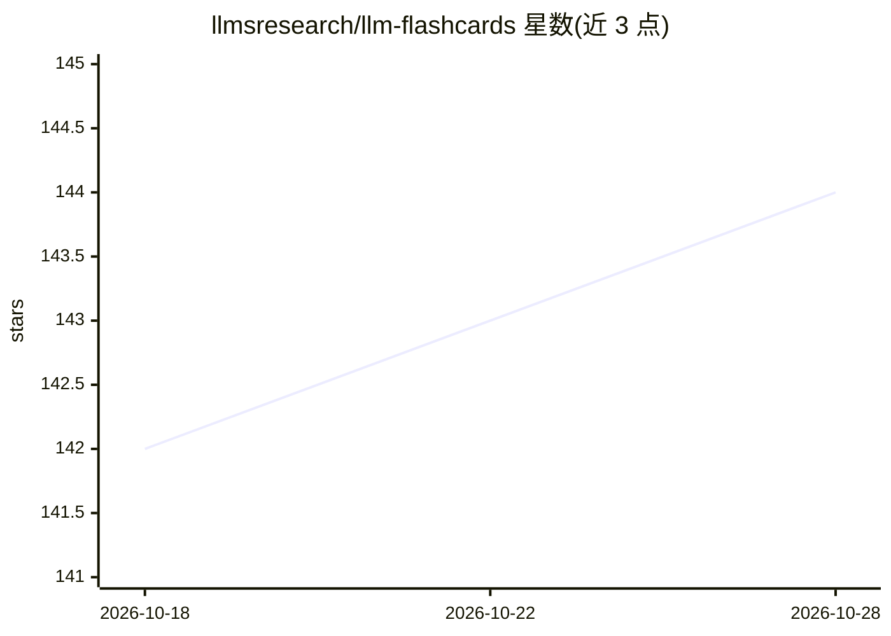

# llmsresearch/llm-flashcards

⭐ 144 · MDX · NOASSERTION · 推送 2026-09-16 · [GitHub](https://github.com/llmsresearch/llm-flashcards) · [官网](https://llmsresearch.com/cards) · 组织维护

**LLM 概念可视化学习卡片集（211 张免费，全集 376 张）**

围绕大语言模型系统的可视化概念卡片库：每张卡片配图示与解释，内容按 tokenization、attention、训练、对齐、推理、RAG、agents、部署与安全等主题层组织，并提供 Attention、RAG、Inference、Agents 四条学习路径。面向准备面试或复习 LLM 概念的学习者。仓库同时是 Astro 站点源码：卡片解释以 MDX 存储，通过 npm 安装依赖、GitHub Actions 构建发布到 llmsresearch.com。全集 376 张卡为付费内容，图片采用 CC BY-NC-ND 4.0 许可。

## 筛选速览

| 维度 | 判定 | 备注 |
|---|---|---|
| AI 角色 | `ai-knowledge` | 知识聚合/清单类 |
| 许可风险 | `none` | NOASSERTION |
| 部署形态 | `library` | 以包/库形式分发 |
| 模型依赖 | — | README 未给出锁定关系 |
| 硬件要求 | — | 无带数字的原话,不猜 |
| 安装摩擦 | `low` | 无编译、无系统依赖或容器化 |
| 成熟度 | — | 结构信号不足 |

## 能力要点

- 211 张免费卡片，每张含图示与解释
- 按 10 个 LLM 系统主题层组织内容
- 提供 Attention/RAG/Inference/Agents 四条学习路径
- Astro 静态站点，MDX 存储卡片内容，GitHub Pages 部署

## 适用场景

- 面试前系统复习 LLM 概念
- 按学习路径从头理解 tokenization 到部署的知识链
- 通过 Anki 样例卡组（30 张）进行间隔重复记忆

## 场景标签

`教程课程` · 领域:学习与行业

## 证据(README 行号)

> L3: One concept per card, with a diagram and an explanation. Use them to prepare for
> L48: The visual cards are organized around the main layers of modern LLM systems:

## 星数曲线

2026-10-18 142 → 2026-10-28 144（+2）

---
*卡片 v1 · prompt 1.4 · 生成 2026-10-22 · 置信度 high · 依据 README sha `f74ac0672436` · [字段定义](../../DATASET.md)*
