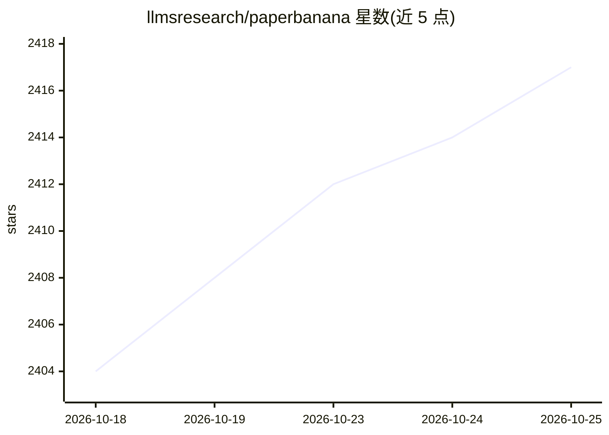

# llmsresearch/paperbanana

⭐ 2,417 · Python · MIT · 推送 2026-09-17 · [GitHub](https://github.com/llmsresearch/paperbanana) · 组织维护

**从方法论文本自动生成学术图表的多智能体框架**

Google Research 论文 PaperBanana 的社区开源实现：输入方法论文本（可选 PDF 页选）与图注，经最多 7 个专职 agent 的两阶段流水线（检索示例→规划→风格化→可视化→评审迭代），产出出版级方法图；另支持通过 VLM 生成 matplotlib 代码的统计绘图、YAML 批量生成、NeurIPS/ICML/ACL/IEEE 风格包、Gradio 本地 Studio、CLI/Python API/MCP server 与 Claude Code skills。接入 OpenAI、Azure OpenAI/Foundry、Google Gemini、Atlas Cloud、OpenRouter 作为 VLM 与图像生成后端。声明与原作者及 Google Research 无关。

## 筛选速览

| 维度 | 判定 | 备注 |
|---|---|---|
| AI 角色 | `ai-native` | 本体是模型或模型工具 |
| 许可风险 | `permissive` | MIT |
| 部署形态 | `self-host` | docker 或自建部署 |
| 模型依赖 | locked-api |  |
| 硬件要求 | — | 无带数字的原话,不猜 |
| 安装摩擦 | `low` | 无编译、无系统依赖或容器化 |
| 成熟度 | — | 结构信号不足 |

## 能力要点

- 两阶段多智能体流水线，Visualizer-Critic 默认迭代 3 轮，--auto 可循环至评审满意
- 统计绘图经 VLM 生成 matplotlib 代码，无需图像生成 API 或凭证
- YAML/JSON manifest 批量生成方法图与统计图，输出 batch_report.json
- 内置 NeurIPS/ICML/ACL/IEEE 风格包，可自建 venue 目录扩展

## 适用场景

- 把论文方法章节文字转成投稿用框架图
- 从 CSV 数据生成符合会议风格的统计图表
- 一次 manifest 批量产出论文全套插图并对比评估

## 场景标签

`多智能体` `图像生成` `科研工具` · 领域:Agent 开发

## 证据(README 行号)

> L28: An agentic framework for generating publication-quality academic diagrams and statistical plots from text descripti
> L163: 4. **Visualizer** renders the description into an image
> L259: Plots are rendered via VLM-generated matplotlib code — no image-generation provider or credentials are required.

## 星数曲线

2026-10-18 2,404 → 2026-10-25 2,417（+13）

---
*卡片 v1 · prompt 1.4 · 生成 2026-10-21 · 置信度 high · 依据 README sha `88c1d2690d8b` · [字段定义](../../DATASET.md)*
