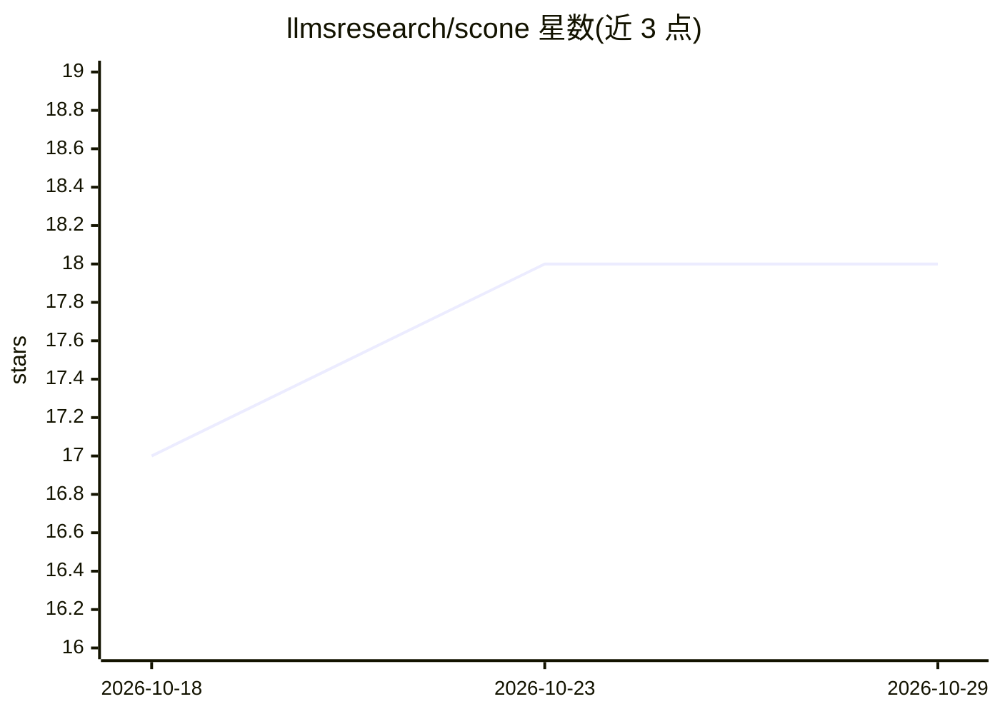

# llmsresearch/scone

⭐ 18 · Python · MIT · 推送 2026-02-02 · [GitHub](https://github.com/llmsresearch/scone) · 个人维护

**SCONE 论文实现：用 n-gram 嵌入扩展语言模型输入层**

论文 "Scaling Embedding Layers in Language Models" 的实现与评估代码库：引入高频 n-gram（f-gram）上下文化嵌入作为输入层扩展，输出层保留原词表；推理时嵌入预计算并存储在加速器外内存（RAM/磁盘），保持推理 FLOPS 不变。面向科研与开发者，提供训练（命令行/YAML/Hydra 配置）、多 GPU 分布式训练、梯度检查点、嵌入预计算缓存、评估、文本生成与基准测试脚本，支持 INT8/INT4/FP16 量化。附 Azure GPU 部署步骤。

## 筛选速览

| 维度 | 判定 | 备注 |
|---|---|---|
| AI 角色 | `ai-native` | 本体是模型或模型工具 |
| 许可风险 | `permissive` | MIT |
| 部署形态 | `None` |  |
| 模型依赖 | — | README 未给出锁定关系 |
| 硬件要求 | — | 无带数字的原话,不猜 |
| 安装摩擦 | `medium` | 含编译或系统依赖之一 |
| 成熟度 | — | 结构信号不足 |

## 能力要点

- f-gram 输入嵌入与输出层解耦，嵌入存于加速器外内存
- 训练/评估/生成/基准测试完整脚本，支持 Hydra 配置与多 GPU
- INT8/INT4/FP16 量化推理
- 嵌入预计算缓存（memory-map）加速推理

## 适用场景

- 复现论文中的 SCONE 训练与评估结果
- 在 GPU 内存受限时用梯度检查点训练较大模型
- 对比不同 f-gram 配置的困惑度与推理速度

## 场景标签

`模型训练` · 领域:训练与推理

## 证据(README 行号)

> L11: This repository contains an implementation of the SCONE (Scalable, Contextualized, Offloaded, N-gram Embedding) met
> L17: SCONE is a method for extending input embedding layers to enhance language model performance as layer size scales. 

## 星数曲线

2026-10-18 17 → 2026-10-29 18（+1）

---
*卡片 v1 · prompt 1.4 · 生成 2026-10-29 · 置信度 high · 依据 README sha `b2855071b4b3` · [字段定义](../../DATASET.md)*
