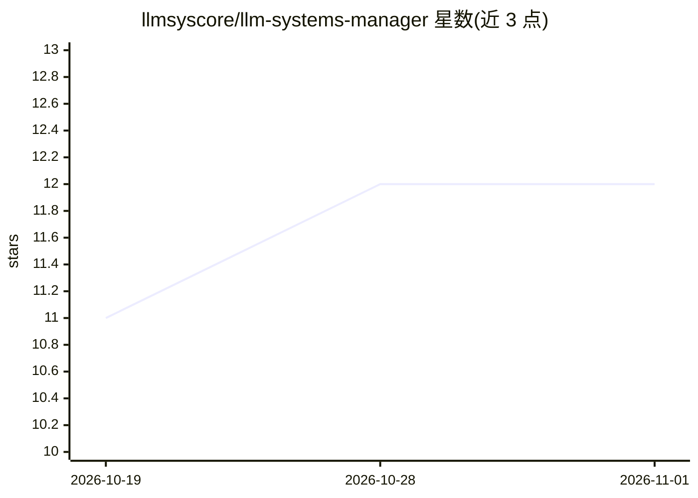

# llmsyscore/llm-systems-manager

⭐ 12 · Python · AGPL-3.0 · 推送 2026-10-31 · [GitHub](https://github.com/llmsyscore/llm-systems-manager) · 组织维护

**自托管面板：监控、控制与调优运行本地 LLM 的机器**

面向本地 LLM 部署的自托管监控与控制面板：通过在 Linux/macOS 主机上部署 agent，实时查看 GPU、功耗、token 吞吐、KV 缓存等指标，支持基准测试与 Autotune 参数调优、模型自动调度（Model Autopilot）、远程控制（启停服务/换模型/开终端）、告警与 OpenAI 兼容网关。兼容 llama.cpp、vLLM、LM Studio，支持 NVIDIA/AMD/Apple Silicon。提供安装脚本、Docker Compose、.deb/.rpm 与 Homebrew 安装，Windows 不支持。

## 筛选速览

| 维度 | 判定 | 备注 |
|---|---|---|
| AI 角色 | `ai-ecosystem` | LLM/agent 周边工具 |
| 许可风险 | `viral` | AGPL-3.0 |
| 部署形态 | `self-host` | docker 或自建部署 |
| 模型依赖 | local-ok | 支持本地模型 |
| 硬件要求 | — | 无带数字的原话,不猜 |
| 安装摩擦 | `low` | 无编译、无系统依赖或容器化 |
| 成熟度 | — | 结构信号不足 |

## 能力要点

- OpenAI 兼容端点按模型路由请求到各机器
- Benchmark/Autotune 调优上下文、KV 缓存、投机解码等参数
- Model Autopilot 按资源保持模型加载并在机器宕机时迁移
- 兼容 llama.cpp、vLLM、LM Studio，支持 NVIDIA/AMD/Apple Silicon

## 适用场景

- 多台机器跑本地 LLM 时统一监控与远程控制
- 对推理服务做基准测试与参数调优
- 统计推理成本与能耗并接收告警
- 用一个兼容 OpenAI 的端点统一访问各机器上的模型

## 场景标签

`模型网关` `LLM 可观测性` · 领域:Agent 开发

## 证据(README 行号)

> L3: One self-hosted dashboard to monitor, control, benchmark and tune every machine that runs your local LLMs.
> L78: - **One API for every machine.** An OpenAI-compatible endpoint that routes each request to a machine serving that m

## 星数曲线

2026-10-19 11 → 2026-11-01 12（+1）

---
*卡片 v1 · prompt 1.4 · 生成 2026-11-01 · 置信度 high · 依据 README sha `72e90ec50466` · [字段定义](../../DATASET.md)*
