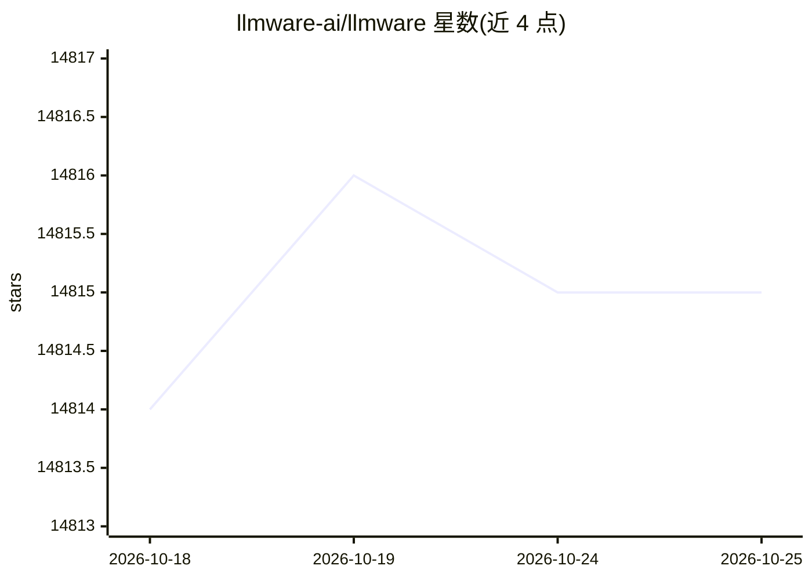

# llmware-ai/llmware

⭐ 14,816 · Python · Apache-2.0 · 推送 2026-10-01 · [GitHub](https://github.com/llmware-ai/llmware) · [官网](https://llmware-ai.github.io/llmware/) · 组织维护

**为企业在本地/边缘设备构建小型专用模型 RAG 应用的统一框架**

llmware 是一个 Python 框架，包含模型目录（300+ 预打包量化模型，含 50+ 自研 SLIM/Bling/Dragon/Industry-Bert 微调模型）与 RAG Pipeline（文档解析、分块、嵌入、知识库构建与查询）两大组件，用于将知识源接入生成式 AI 模型。推理层支持 GGUF、OpenVINO、ONNXRuntime、ONNXRuntime-QNN、WindowsLocalFoundry、Pytorch 等后端，并支持 OpenAI、Anthropic、Google 云端模型；数据层提供 3 种文本库与 10 种向量库组合，默认 SQLite+ChromaDB 开箱即用。主要面向企业流程自动化场景。

## 筛选速览

| 维度 | 判定 | 备注 |
|---|---|---|
| AI 角色 | `ai-ecosystem` | LLM/agent 周边工具 |
| 许可风险 | `permissive` | Apache-2.0 |
| 部署形态 | `self-host` | docker 或自建部署 |
| 模型依赖 | local-ok | 支持本地模型 |
| 硬件要求 | — | 无带数字的原话,不猜 |
| 安装摩擦 | `low` | 无编译、无系统依赖或容器化 |
| 成熟度 | — | 结构信号不足 |

## 动量与使用信号

- 维护:`active` — 距上次 push 16.7 天,年发版 4,77 位贡献者
- 涨星:近 1 天 **-1**(自 20261016 起算)
- 安装:pypi 包 `llmware` 月下载 1,409
- 平台:WINDOWS / LINUX · 协议:OPENAI-API / OLLAMA

## 能力要点

- 模型目录含 300+ 模型，其中 50+ 为 RAG 优化的小参数量微调模型（1-7B）
- 支持 GGUF、OpenVINO、ONNXRuntime-QNN（骁龙 NPU）等多推理后端
- 集成 3 种文本数据库与 10 种向量数据库，含 Docker Compose 部署脚本
- LLMfx Agent 支持基于 SLIM 模型的函数调用多步工作流

## 适用场景

- 在本地笔记本或企业内网环境运行知识库问答与文档分析
- 解析 PDF/Word/PPT/Excel 等文档构建可查询知识库
- 用 SLIM 模型在 CPU 上跑多步骤函数调用 Agent
- 对合同等业务文档做问题回答与键值提取

## 场景标签

`RAG` `文档解析` `Agent 框架` · 领域:Agent 开发

## 证据(README 行号)

> L9: `llmware` is optimized for AI PC and local laptop, edge and self-hosted deployment across a wide range of Windows, M
> L13:  1. **Model catalog with 300+ models** - models prepackaged in quantized, optimized formats, to leverage on device 
> L15:  2. **RAG Pipeline** - integrated components for the full lifecycle of connecting knowledge sources to generative A

## 星数曲线

2026-10-18 14,814 → 2026-10-25 14,815（+1）

---
*卡片 v1 · prompt 1.4 · 生成 2026-10-18 · 置信度 high · 依据 README sha `faab47c6beb8` · [字段定义](../../DATASET.md)*
