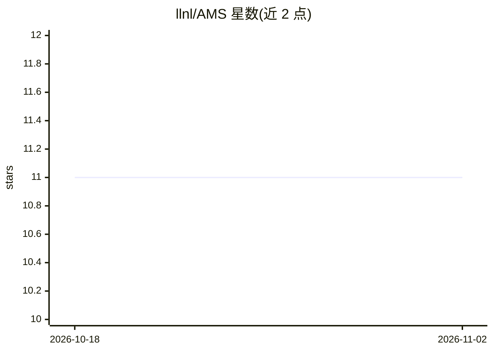

# llnl/AMS

⭐ 11 · C++ · Apache-2.0 · 推送 2026-10-30 · [GitHub](https://github.com/llnl/AMS) · 组织维护

**面向 HPC 代码集成 ML 代理模型的库（建设中）**

Lawrence Livermore 国家实验室开源项目（LDRD-SI 22-SI-004 产出），定位为简化机器学习代理模型在 HPC 代码中集成使用的库，README 自述仍在建设中。项目以 Apache 2.0（含 LLVM 例外）许可发布，代码标识 LLNL-CODE-851455；README 仅给出贡献流程与引用条目，安装与开发容器细节分别指向 INSTALL.md 与 DEVCONTAINERS.md，缺少功能细节。

## 筛选速览

| 维度 | 判定 | 备注 |
|---|---|---|
| AI 角色 | `ai-ecosystem` | LLM/agent 周边工具 |
| 许可风险 | `permissive` | Apache-2.0 |
| 部署形态 | `None` |  |
| 模型依赖 | — | README 未给出锁定关系 |
| 硬件要求 | — | 无带数字的原话,不猜 |
| 安装摩擦 | `low` | 无编译、无系统依赖或容器化 |
| 成熟度 | `idea` | |

## 能力要点

- 定位：简化 ML 代理模型在 HPC 代码中的集成
- Apache 2.0 with LLVM exceptions 许可
- 支持 Dev Containers 开发环境（见 DEVCONTAINERS.md）

## 适用场景

- 在 HPC 模拟代码中接入机器学习代理模型
- 研究 multiscale 模拟与 ML 结合的开发者参与贡献

## 场景标签

 · 领域:HPC/科学计算

## 证据(README 行号)

> L6: A library (under construction) to simplify machine learning surrogate model integration in HPC codes.
> L22: AMS was created under the AMS LDRD-SI project (22-SI-004).

## 星数曲线

2026-10-18 11 → 2026-11-02 11（+0）

---
*卡片 v1 · prompt 1.4 · 生成 2026-11-02 · 置信度 low · 依据 README sha `13c274203297` · [字段定义](../../DATASET.md)*
