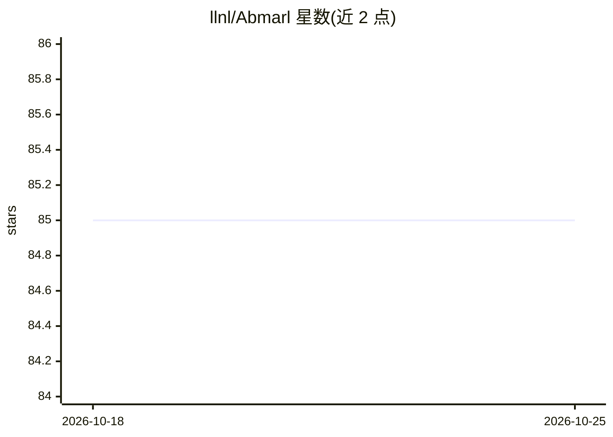

# llnl/Abmarl

⭐ 85 · Python · NOASSERTION · 推送 2026-05-11 · [GitHub](https://github.com/llnl/Abmarl) · 组织维护

**开发多智能体仿真并用 MARL 训练的 Python 框架**

Abmarl 是劳伦斯利弗莫尔国家实验室（LLNL）维护的 Python 包，用于构建 Agent-Based 仿真并通过多智能体强化学习（MARL）进行训练。它定义仿真接口与 Simulation Manager，支持 gym.Env、MultiAgentEnv、OpenSpiel 等仿真接口集成，内置 GridWorld 仿真框架，并基于 RLlib 框架扩展以支持自定义仿真、算法与策略。提供命令行工具覆盖训练、可视化、分析全流程，面向科研人员快速原型化 MARL 实验。可通过 pip 安装，conda 环境需额外安装 ffmpeg。

## 筛选速览

| 维度 | 判定 | 备注 |
|---|---|---|
| AI 角色 | `ai-native` | 本体是模型或模型工具 |
| 许可风险 | `none` | NOASSERTION |
| 部署形态 | `library` | 以包/库形式分发 |
| 模型依赖 | — | README 未给出锁定关系 |
| 硬件要求 | — | 无带数字的原话,不猜 |
| 安装摩擦 | `medium` | 含编译或系统依赖之一 |
| 成熟度 | — | 结构信号不足 |

## 能力要点

- 定义 Agent-Based 仿真接口与 Simulation Manager
- 支持 gym.Env、MultiAgentEnv、OpenSpiel 等仿真接口集成
- 基于 RLlib 扩展，支持自定义仿真、算法与策略
- 内置 GridWorld 仿真框架与命令行训练/可视化/分析工具

## 适用场景

- 构建网格类多智能体仿真环境
- 用 MARL 算法训练智能体并可视化其行为
- 在既有项目中快速原型化强化学习方案

## 场景标签

`多智能体` `强化学习` · 领域:Agent 开发

## 证据(README 行号)

> L3: Abmarl is a package for developing Agent-Based Simulations and training them with
> L13: Abmarl leverages RLlib’s framework for reinforcement learning and extends it to

## 星数曲线

2026-10-18 85 → 2026-10-25 85（+0）

---
*卡片 v1 · prompt 1.4 · 生成 2026-10-24 · 置信度 high · 依据 README sha `a92a35a078fd` · [字段定义](../../DATASET.md)*
