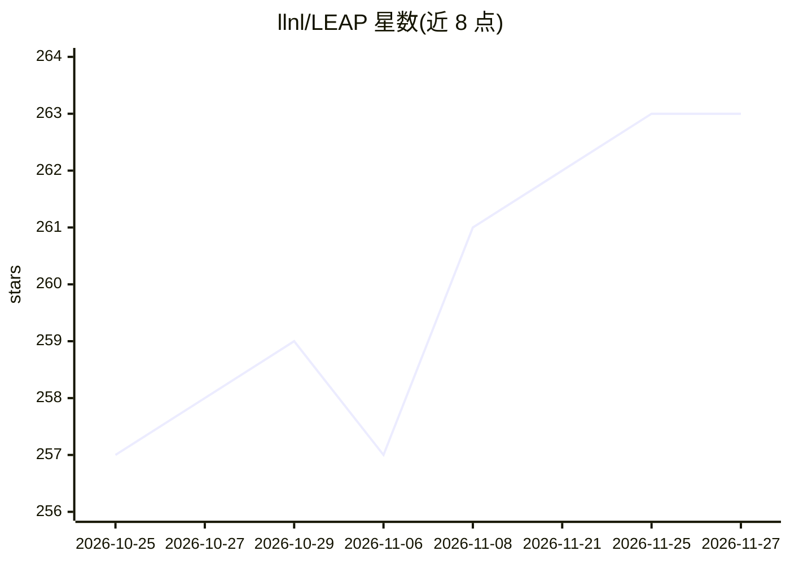

# llnl/LEAP

⭐ 263 · C++ · MIT · 推送 2026-11-07 · [GitHub](https://github.com/llnl/LEAP) · [官网](https://leapct.readthedocs.io) · 组织维护

**LLNL 出品的 3D CT 重建算法库，含 Python/C++ API 与 PyQt GUI**

C++/CUDA 实现的 3D 断层成像算法库，覆盖预处理、正/反投影器、FBP 解析重建与迭代重建，提供 Python 接口与 PyQt GUI，支持 Linux/Windows/Mac（Mac 无 GPU 支持）。投影器实现多 GPU 与多核 CPU 版本，并通过 PyTorch 绑定提供可微分的正反向投影，供 AI/ML 驱动的 CT 应用使用。安装支持预编译 wheel 与可编辑开发构建，GPU 后端可选 NVIDIA（CUDA）或 AMD（ROCm/HIP），也可强制 CPU-only。

## 筛选速览

| 维度 | 判定 | 备注 |
|---|---|---|
| AI 角色 | `ai-native` | 本体是模型或模型工具 |
| 许可风险 | `permissive` | MIT |
| 部署形态 | `library` | 以包/库形式分发 |
| 模型依赖 | — | README 未给出锁定关系 |
| 硬件要求 | `cpu-ok` | |
| 安装摩擦 | `high` | 编译与系统依赖俱全 |
| 成熟度 | — | 结构信号不足 |

## 能力要点

- Python/C++ 双 API，附带 PyQt GUI
- PyTorch 绑定提供可微分正/反投影器
- 多 GPU 与多核 CPU 投影实现，支持 CUDA 与 ROCm/HIP 后端
- 可配合 XrayPhysics 包做散射校正、射束硬化校正与双能分解

## 适用场景

- 锥束/螺旋 CT 数据的 FBP 与迭代重建
- 构建可微分投影层用于深度学习 CT 模型训练
- CT 数据的射束硬化与散射等物理校正预处理

## 场景标签

 · 领域:医学/科学成像

## 证据(README 行号)

> L1: # LivermorE AI Projector for Computed Tomography (LEAP)
> L2: This is a C++/CUDA library (Linux, Windows, and Mac*) of 3D tomographic algorithms (pre-processing algorithms, proje

## 星数曲线

2026-10-25 257 → 2026-11-27 263（+6）

---
*卡片 v1 · prompt 1.4 · 生成 2026-11-25 · 置信度 high · 依据 README sha `df6ca4965ea3` · [字段定义](../../DATASET.md)*
