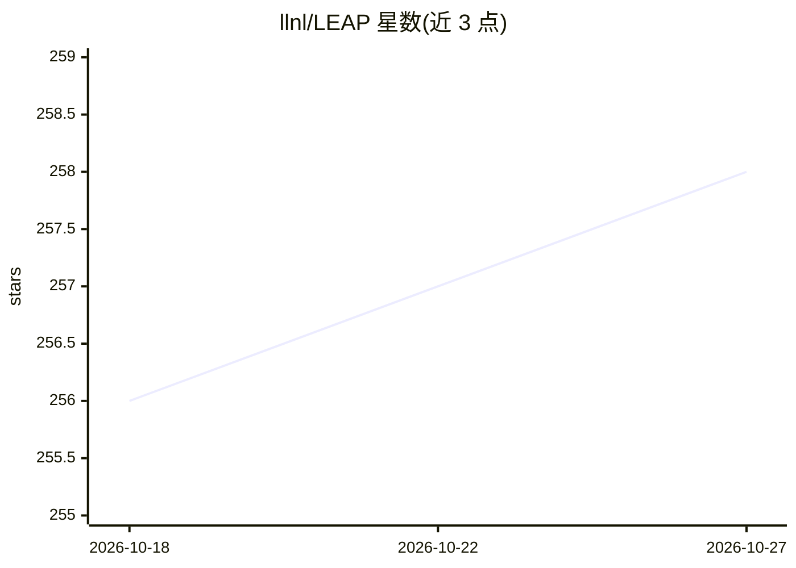

# llnl/LEAP

⭐ 258 · Cuda · MIT · 推送 2026-07-25 · [GitHub](https://github.com/llnl/LEAP) · [官网](https://leapct.readthedocs.io) · 组织维护

**三维 CT 投影与重建算法库（C++/CUDA，含 PyTorch 绑定）**

面向计算断层成像的 C++/CUDA 算法库，覆盖预处理、前后向投影、FBP 解析重建与迭代重建，支持多 GPU 与多核 CPU，Linux/Windows/Mac 可用（Mac 版无 GPU 支持且缺部分功能）。通过 PyTorch 绑定提供可微分的前向与反向投影，用于 AI/ML 驱动的 CT 应用；配合 XrayPhysics 包可做散射校正、束硬化校正等物理建模。提供 PyQt GUI、demo 脚本，安装与用法在 wiki 页面。

## 筛选速览

| 维度 | 判定 | 备注 |
|---|---|---|
| AI 角色 | `ai-enhanced` | 去掉 AI 部分产品仍成立 |
| 许可风险 | `permissive` | MIT |
| 部署形态 | `None` |  |
| 模型依赖 | — | README 未给出锁定关系 |
| 硬件要求 | — | 无带数字的原话,不猜 |
| 安装摩擦 | `medium` | 含编译或系统依赖之一 |
| 成熟度 | — | 结构信号不足 |

## 能力要点

- 3D 层析算法：预处理、投影器、FBP 与迭代重建
- 多 GPU 与多核 CPU 实现的前向/反向投影
- PyTorch 绑定提供可微分投影，支持 AI/ML CT 应用
- 配合 XrayPhysics 包可进行散射/束硬化校正等物理建模

## 适用场景

- 我需要为 CT 重建研究实现前后向投影
- 我要构建可微分的 CT 重建深度学习流程
- 我需要 FBP/迭代重建算法进行断层成像实验

## 场景标签

`图像视频处理` · 领域:感知与多模态

## 证据(README 行号)

> L2: This is a C++/CUDA library (Linux, Windows, and Mac*) of 3D tomographic algorithms (pre-processing algorithms, proje
> L20: Demo scripts for AI/ML/DL applications in the demo_leaptorch directory

## 星数曲线

2026-10-18 256 → 2026-10-27 258（+2）

---
*卡片 v1 · prompt 1.4 · 生成 2026-10-22 · 置信度 mid · 依据 README sha `8ae41d09d59d` · [字段定义](../../DATASET.md)*
