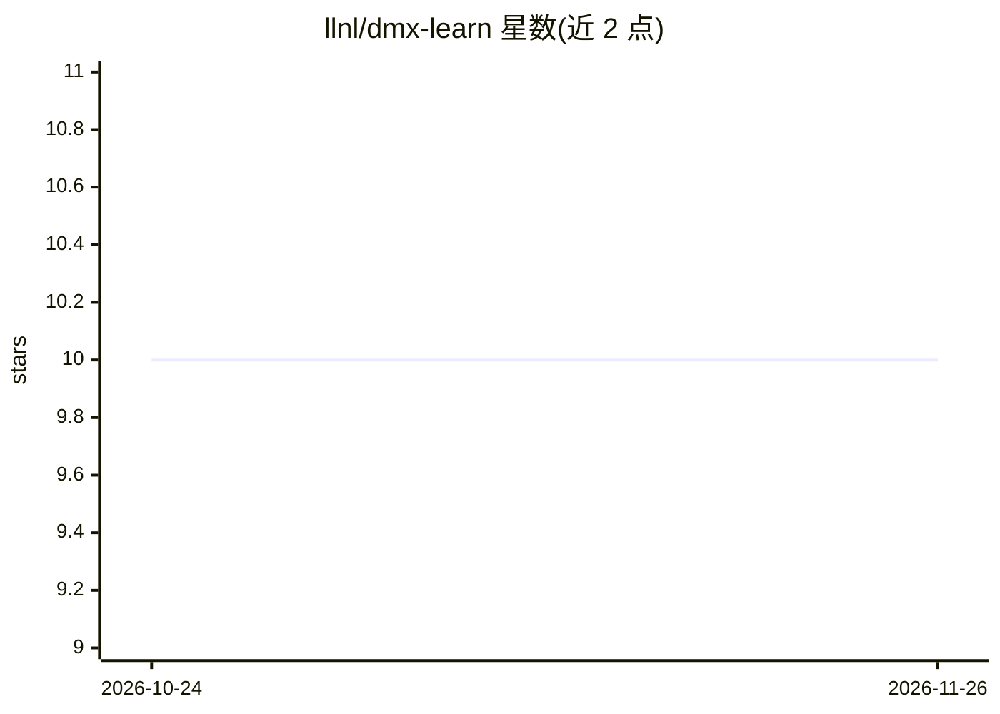

# llnl/dmx-learn

⭐ 10 · Jupyter Notebook · BSD-3-Clause · 推送 2026-11-04 · [GitHub](https://github.com/llnl/dmx-learn) · 组织维护

**科研人员对异构数据拟合分布式混合密度模型的 Python 库**

实现 Distributed Mixture Learning 的 Python 包：在变长异构数据上指定并拟合复杂的混合密度模型。核心分布基于 scipy/numba，提供自动模型选择、嵌入和随机图工具；可选 PyTorch 后端实现 GPU 加速分布，可选 mpi4py 与 Apache Spark 支持分布式计算。通过 Poetry 或 pip 安装，文档托管在 Read the Docs，BSD 3-Clause 许可，由 LLNL 维护。

## 筛选速览

| 维度 | 判定 | 备注 |
|---|---|---|
| AI 角色 | `ai-native` | 本体是模型或模型工具 |
| 许可风险 | `permissive` | BSD-3-Clause |
| 部署形态 | `library` | 以包/库形式分发 |
| 模型依赖 | — | README 未给出锁定关系 |
| 硬件要求 | — | 无带数字的原话,不猜 |
| 安装摩擦 | `low` | 无编译、无系统依赖或容器化 |
| 成熟度 | — | 结构信号不足 |

## 能力要点

- 对变长异构数据进行分布式混合密度估计
- 可选 PyTorch 后端提供 GPU 加速分布计算
- 支持 Spark 与 MPI 两种分布式运行方式
- 提供自动模型选择与嵌入等工具示例

## 适用场景

- 在异构变长数据上做密度估计与混合模型拟合
- 用 Spark 或 MPI 集群进行分布式模型训练
- 用 PyTorch 在 GPU 上加速分布计算

## 场景标签

 · 领域:机器学习/统计分析

## 证据(README 行号)

> L9: **Distributed Mixture Learning** - A package for distributed heterogeneous density estimation. With only a few lines
> L162: ## 🔥 PyTorch Support (Optional)

## 星数曲线

2026-10-24 10 → 2026-11-26 10（+0）

---
*卡片 v1 · prompt 1.4 · 生成 2026-11-19 · 置信度 high · 依据 README sha `ca9a54232c37` · [字段定义](../../DATASET.md)*
