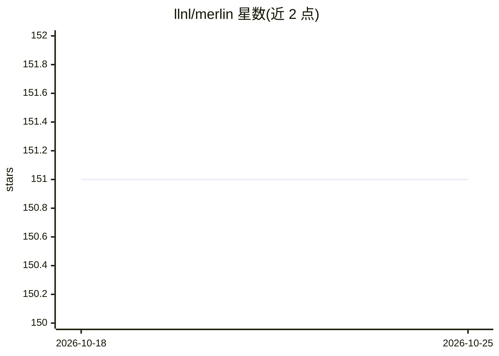

# llnl/merlin

⭐ 151 · Python · NOASSERTION · 推送 2026-05-29 · [GitHub](https://github.com/llnl/merlin) · 组织维护

**面向 HPC 的分布式机器学习工作流编排与任务队列系统**

由 LLNL 开发的机器学习工作流运行工具：以持久化外部队列服务器协调任务依赖，集群各节点上的 Celery worker 从中央服务器拉取任务，支持多个批次分配共同参与（surge computing）以及 CPU/GPU worker 分工，可用于设计空间智能采样与强化学习等动态工作流。基于 maestro 描述 DAG 工作流，经 Celery 转为具体任务，后端支持 RabbitMQ 与 Redis，可选配合 Flux 对接 HPC 批处理系统。曾支撑 Sierra 超算上 1 亿次模拟规模，已用于惯性约束聚变等研究。通过 pip 安装，需 Python 3.8+ 并配置外部 RabbitMQ/Redis 服务器。

## 筛选速览

| 维度 | 判定 | 备注 |
|---|---|---|
| AI 角色 | `ai-ecosystem` | LLM/agent 周边工具 |
| 许可风险 | `none` | NOASSERTION |
| 部署形态 | `library` | 以包/库形式分发 |
| 模型依赖 | — | README 未给出锁定关系 |
| 硬件要求 | — | 无带数字的原话,不猜 |
| 安装摩擦 | `low` | 无编译、无系统依赖或容器化 |
| 成熟度 | — | 结构信号不足 |

## 能力要点

- 持久化中央队列服务器协调任务依赖，不依赖文件系统通信
- 支持多批次分配共同参与工作与 CPU/GPU worker 专门化分工
- worker 可向服务器回加任务，实现动态工作流（智能采样、强化学习）
- 基于 maestro DAG 描述工作流，Celery 执行，后端支持 RabbitMQ/Redis

## 适用场景

- 在大规模 HPC 集群上运行数以万计的模拟以生成训练数据集
- 用生成的数据训练深度神经网络以模仿 HPC 应用，用于设计优化与不确定性量化
- 协调 CPU 模拟节点与 GPU 训练节点共同完成认知模拟工作流

## 场景标签

`工作流自动化` `强化学习` · 领域:效率与自动化

## 证据(README 行号)

> L10: Merlin is a tool for running machine learning based workflows. The goal of
> L49: Merlin does all of this by leveraging some key HPC and cloud computing

## 星数曲线

2026-10-18 151 → 2026-10-25 151（+0）

---
*卡片 v1 · prompt 1.4 · 生成 2026-10-22 · 置信度 high · 依据 README sha `bbd28b5904bf` · [字段定义](../../DATASET.md)*
