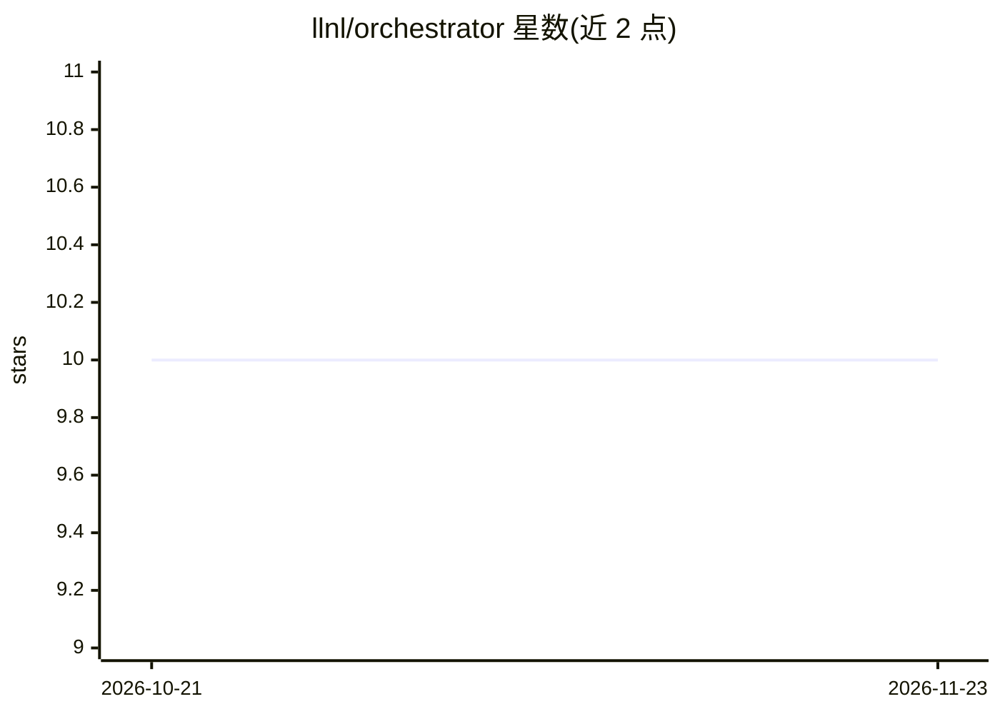

# llnl/orchestrator

⭐ 10 · Python · Apache-2.0 · 推送 2026-07-14 · [GitHub](https://github.com/llnl/orchestrator) · [官网](https://orchestrator-docs.readthedocs.io/en/latest/index.html) · 组织维护

**为科研人员提供原子间势构建训练与分子动力学模拟流程框架**

LLNL 在 LDRD 项目下开发的模块化 Python 框架，用于整合构建、训练、测试、增强、运行与分析原子间势（IAP）的流程，并执行和评估由此实现的大规模分子动力学模拟。框架为众多相关计算代码提供统一接口，将领域技术经验编码进软件以减少人工集成时间。README 主要面向贡献者说明 PEP8/yapf/flake8/pre-commit 风格规范、提交消息代码与 Apache 2.0 with LLVM exception 许可；安装依赖与环境设置指向外部文档。

## 筛选速览

| 维度 | 判定 | 备注 |
|---|---|---|
| AI 角色 | `ai-native` | 本体是模型或模型工具 |
| 许可风险 | `permissive` | Apache-2.0 |
| 部署形态 | `library` | 以包/库形式分发 |
| 模型依赖 | — | README 未给出锁定关系 |
| 硬件要求 | — | 无带数字的原话,不猜 |
| 安装摩擦 | `low` | 无编译、无系统依赖或容器化 |
| 成熟度 | — | 结构信号不足 |

## 能力要点

- 构建/训练/测试/运行/分析原子间势的一体化工作流
- 为众多相关计算代码提供统一接口
- 面向研究者编码领域专业知识以减少集成时间

## 适用场景

- 训练和评估材料科学领域的机器学习原子间势
- 运行大规模分子动力学模拟并分析结果
- 在统一接口下整合多种 IAP 相关计算代码

## 场景标签

`科研工具` `工作流自动化` · 领域:效率与自动化

## 证据(README 行号)

> L5: Initiaive at Lawrence Livermore National Lab. It aims to streamline the complex
> L6: workflows of building, training, and analyzing Interatomic Potentials (IAPs)
> L7: alongside the execution and analysis of large scale MD simulations made

## 星数曲线

2026-10-21 10 → 2026-11-23 10（+0）

---
*卡片 v1 · prompt 1.4 · 生成 2026-11-19 · 置信度 low · 依据 README sha `31c22bef9f8a` · [字段定义](../../DATASET.md)*
