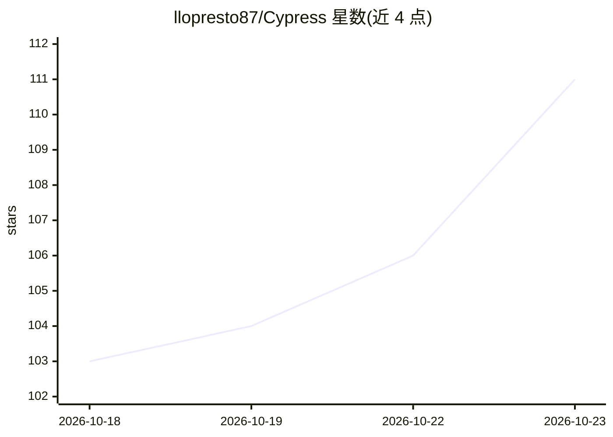

# llopresto87/Cypress

⭐ 111 · Python · MIT · 推送 2026-10-14 · [GitHub](https://github.com/llopresto87/Cypress) · 个人维护

**向 AI 编码工具注入多 agent 专家团队与知识图方法的安装器**

CYPRESS 是一个项目与厂商无关的安装器：向已有 AI 编码工具（Claude Code、Prime Agent、opencode 等）所在仓库复制指令文件、Markdown 方法文档与少量仅依赖 Python 3.14 标准库的脚本。首次会话读取仓库构建渐进发现的知识图，后续按路由索引按需加载节点。方法要求按风险分层（T0-T3）定制流程、先写规格与失败测试、将需干净上下文的步骤交给子 agent（architect/tester/reviewer 等）。Codex 与 GitHub Copilot 支持已声明为弃用。README 明确列出哪些环节是对模型的请求而非工具强制。

## 筛选速览

| 维度 | 判定 | 备注 |
|---|---|---|
| AI 角色 | `ai-ecosystem` | LLM/agent 周边工具 |
| 许可风险 | `permissive` | MIT |
| 部署形态 | `None` |  |
| 模型依赖 | — | README 未给出锁定关系 |
| 硬件要求 | — | 无带数字的原话,不猜 |
| 安装摩擦 | `low` | 无编译、无系统依赖或容器化 |
| 成熟度 | — | 结构信号不足 |

## 能力要点

- 安装器形式向仓库写入内核指令、agent 定义、技能与知识图骨架
- 风险分层（T0-T3）决定流程强度，含规格先行与测试先行
- 渐进发现知识图：每事实一个节点，按路由索引按需加载
- 支持 Claude Code/Prime Agent/opencode，Codex 与 Copilot 已弃用

## 适用场景

- 为我在用的 AI 编码工具配置一套多角色协作工作流
- 让长会话按需加载项目知识而非反复读全部代码
- 在仓库中引入规格与测试先行的分层开发流程

## 场景标签

`Agent 框架` `多智能体` · 领域:Agent 开发

## 证据(README 行号)

> L5: CYPRESS is an installer that gives the AI coding tool you already use a written way of working on your repository. I
> L11: It is for developers who work in a code repository through a coding harness the installer supports: Claude Code, Pr

## 星数曲线

2026-10-18 103 → 2026-10-23 111（+8）

---
*卡片 v1 · prompt 1.4 · 生成 2026-10-23 · 置信度 high · 依据 README sha `4c42edca3387` · [字段定义](../../DATASET.md)*
