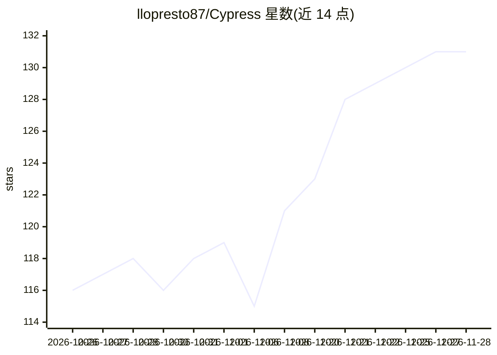

# llopresto87/Cypress

⭐ 131 · Python · MIT · 推送 2026-11-11 · [GitHub](https://github.com/llopresto87/Cypress) · 个人维护

**给 AI 编码工具安装多角色专家工作流与知识图谱的种子包**

CYPRESS 是一个安装器，向用户已有的 AI 编码工具（Claude Code、opencode、Prime Agent 等）所在仓库写入指令文件、Markdown 方法文件和少量 Python 脚本（仅需 Python 3.14 标准库）。它本身不是库、服务或模型。安装后用户粘贴一条入口提示，会话读取仓库并构建渐进发现的知识图谱；方法要求按风险分级（T0-T3）决定流程、先写规格与失败测试、把需要干净上下文的步骤交给子 agent。多数规则由模型自愿遵循，仅少数由 linter/hook 校验。

## 筛选速览

| 维度 | 判定 | 备注 |
|---|---|---|
| AI 角色 | `ai-ecosystem` | LLM/agent 周边工具 |
| 许可风险 | `permissive` | MIT |
| 部署形态 | `None` |  |
| 模型依赖 | — | README 未给出锁定关系 |
| 硬件要求 | — | 无带数字的原话,不猜 |
| 安装摩擦 | `low` | 无编译、无系统依赖或容器化 |
| 成熟度 | — | 结构信号不足 |

## 能力要点

- 向仓库写入内核指令文件、协议方法与渐进发现知识图谱
- architect/tester/reviewer 等按角色定义的多 agent 分工
- 按 T0-T3 风险分级决定规格、测试与评审流程强度
- README 明确列出多数机制为「请求而非强制」及未测量项

## 适用场景

- 在已有 AI 编码工具的仓库中建立规格先行、测试先行的流程
- 让多个会话共享渐进加载的项目知识图谱以控制上下文
- 按任务风险决定多 agent 评审与委派的严格程度

## 场景标签

`多智能体` `知识图谱` · 领域:Agent 开发

## 证据(README 行号)

> L5: CYPRESS is an installer that gives the AI coding tool you already use a written way of working on your repository. I
> L11: It is for developers who work in a code repository through a coding harness the installer supports: Claude Code, Pr
> L56: CYPRESS is a written workflow, not a program. The session reads which steps a task needs and in what order, carries

## 星数曲线

2026-10-26 116 → 2026-11-28 131（+15）

---
*卡片 v1 · prompt 1.4 · 生成 2026-11-28 · 置信度 high · 依据 README sha `40deaeb2492b` · [字段定义](../../DATASET.md)*
