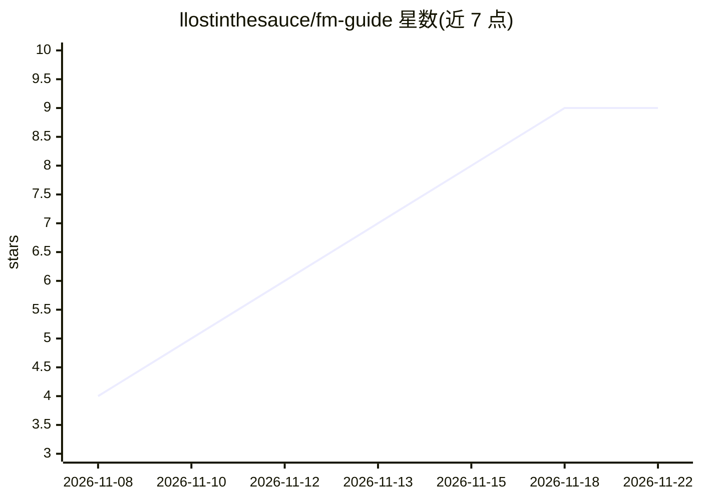

# llostinthesauce/fm-guide

⭐ — · [GitHub]() · 个人维护

**macOS 27 内置 fm Foundation Models CLI 的实战使用指南**

一份文档类仓库，记录 macOS 27 随系统附带的 Foundation Models 命令行工具 fm 的使用要点：上下文与吞吐量实测数据、结构化输出与 x-order 规则、fm serve 提供的本地 OpenAI 兼容端点（支持流式、视觉、JSON Schema）、工具调用在 2.0.68 上的故障与安全注意事项。面向需要在 Apple silicon 上运行本地端侧模型的开发者，含 CLI 参考、Serve API、引导生成与性能上限四篇指南。

## 筛选速览

| 维度 | 判定 | 备注 |
|---|---|---|
| AI 角色 | `ai-knowledge` | 知识聚合/清单类 |
| 许可风险 | `permissive` | — |
| 部署形态 | `None` |  |
| 模型依赖 | — | README 未给出锁定关系 |
| 硬件要求 | — | 无带数字的原话,不猜 |
| 安装摩擦 | `low` | 无编译、无系统依赖或容器化 |
| 成熟度 | — | 结构信号不足 |

## 能力要点

- fm serve 提供本地 OpenAI 兼容端点，离线运行、无 API key、无按 token 计费
- 实测数据：8,192 token 上下文、约 42–46 tokens/s 生成速度
- 记录结构化输出约束规则与工具调用在 2.0.68 上的故障
- 覆盖 CLI 参考、Serve API、引导生成、性能上限四篇指南

## 适用场景

- 在 Apple silicon Mac 上通过 fm serve 搭建本地 OpenAI 兼容端点
- 用 fm 的 JSON Schema 约束生成结构化输出
- 了解 fm 的上下文上限、速度与护栏行为后再决定使用方式

## 场景标签

`教程课程` · 领域:学习与行业

## 证据(README 行号)

> L1: # fm-guide
> L5: Apple's built-in help covers the flags. This guide covers what you only find out by using the tool: the limits, the 
> L31: |Guide|What's in it|

## 星数曲线

2026-11-08 4 → 2026-11-22 9（+5）

---
*卡片 v1 · prompt 1.4 · 生成 2026-11-20 · 置信度 high · 依据 README sha `f1e99bec4ce3` · [字段定义](../../DATASET.md)*
