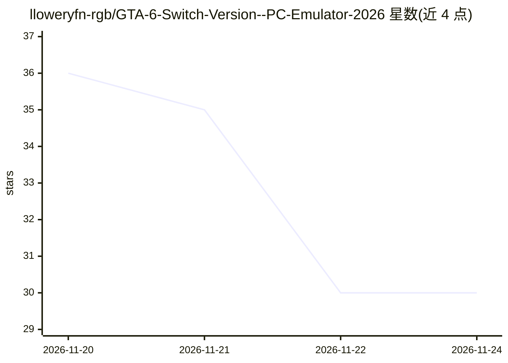

# lloweryfn-rgb/GTA-6-Switch-Version--PC-Emulator-2026

⭐ 30 · Rust · Apache-2.0 · 推送 2026-11-19 · [GitHub](https://github.com/lloweryfn-rgb/GTA-6-Switch-Version--PC-Emulator-2026) · 个人维护

**面向 Windows 玩家的 GTA VI PC 版安装与配置指南**

一个面向 Windows 10/11 玩家的 GTA VI PC 版准备工作资源站：提供 Windows 环境检查、显卡驱动更新指引（NVIDIA/AMD/Intel 链接）、存储检查、Rockstar Games Launcher 准备、常见安装错误类别与 FPS/卡顿排查条目。附带的 Windows 安装包为独立的配套工具，README 明确声明其不包含也不安装 GTA VI 游戏文件；官方 PC 版发售日期与配置要求截至声明日期均未公布，表格留空待更新。

## 筛选速览

| 维度 | 判定 | 备注 |
|---|---|---|
| AI 角色 | `ai-knowledge` | 知识聚合/清单类 |
| 许可风险 | `permissive` | Apache-2.0 |
| 部署形态 | `desktop` | 安装包/桌面程序 |
| 模型依赖 | — | README 未给出锁定关系 |
| 硬件要求 | — | 无带数字的原话,不猜 |
| 安装摩擦 | `low` | 无编译、无系统依赖或容器化 |
| 成熟度 | `idea` | |

## 能力要点

- 覆盖 Windows 检查、驱动验证、存储检查的安装准备清单
- 图形设置与 FPS/卡顿排查条目（分辨率、阴影、帧生成等）
- 提供 NVIDIA/AMD/Intel 官方驱动下载链接
- README 声明配套安装器不含游戏文件，游戏需经授权渠道购买

## 适用场景

- PC 版 GTA VI 发售前提前准备 Windows 环境与驱动
- 排查安装错误与 FPS 低下、卡顿等常见问题
- 了解官方 PC 配置要求的公布进度

## 场景标签

 · 领域:游戏/桌面工具

## 证据(README 行号)

> L5: A dedicated PC installation and configuration resource for Grand Theft Auto VI, covering Windows preparation, graphi
> L19: The installation resource focuses on:
> L49: The companion installer does not contain or install GTA VI game files.

## 星数曲线

2026-11-20 36 → 2026-11-24 30（-6）

---
*卡片 v1 · prompt 1.4 · 生成 2026-11-20 · 置信度 mid · 依据 README sha `6954d37a13d3` · [字段定义](../../DATASET.md)*
