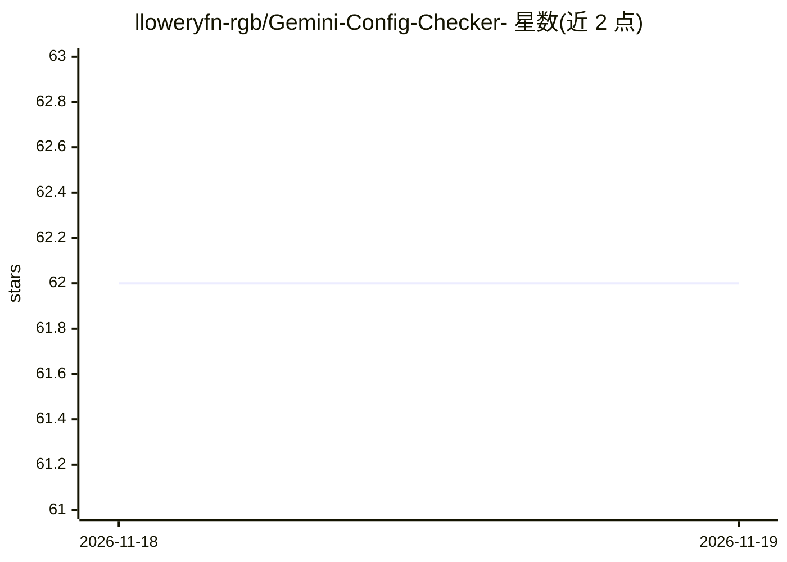

# lloweryfn-rgb/Gemini-Config-Checker-

⭐ 62 · Go · Apache-2.0 · 推送 2026-11-18 · [GitHub](https://github.com/lloweryfn-rgb/Gemini-Config-Checker-) · 个人维护

**检测哪些代理配置能实际访问 Google AI Studio 与 Gemini**

以登录态浏览器方式逐条测试代理配置的 CLI/桌面工具：用户粘贴 vless/vmess/trojan/ss 链接、订阅 URL 或 base64，或选用现成免费配置列表；工具先做连通性快筛，再打开 Chrome/Edge/Brave 登录 Google 后读取 AI Studio 与 Gemini 的区域封锁判定。提供 Simple/Advanced 两种模式（后者将免费配置链在可用基础配置之后），内置可编辑的反 DPI 分片配置（Finalmask/指纹/ALPN/密码套件），结果可导出为链接、base64 或 Xray 配置。版本 0.1.0 为早期预发布，仅 Windows 经过实测。

## 筛选速览

| 维度 | 判定 | 备注 |
|---|---|---|
| AI 角色 | `ai-enhanced` | 去掉 AI 部分产品仍成立 |
| 许可风险 | `permissive` | Apache-2.0 |
| 部署形态 | `desktop` | 安装包/桌面程序 |
| 模型依赖 | — | README 未给出锁定关系 |
| 硬件要求 | — | 无带数字的原话,不猜 |
| 安装摩擦 | `medium` | 含编译或系统依赖之一 |
| 成熟度 | `idea` | |

## 能力要点

- 登录态浏览器检测：读取 Google 对已登录账号显示的区域封锁结果
- Simple/Advanced 双模式，支持基础配置+免费配置链式扫描
- 可编辑的 Anti-DPI 分片配置，含本地分片转发器
- 每配置导出链接/base64/完整或链式 Xray 配置，附带 SHA256 校验

## 适用场景

- 批量测试手头的代理配置哪些能进 AI Studio 和 Gemini
- Cloudflare 配置连通但被 Google 区域墙拦截时，寻找其他可用出口
- 依赖某配置前先验证一次实际可用性

## 场景标签

 · 领域:网络工具/代理配置检测

## 证据(README 行号)

> L11: Find proxy configs that actually get you into **Google AI Studio and Gemini**, by testing each one the way a person
> L9: # Gemini Config Checker

## 星数曲线

2026-11-18 62 → 2026-11-19 62（+0）

---
*卡片 v1 · prompt 1.4 · 生成 2026-11-19 · 置信度 high · 依据 README sha `7d4e3e000e83` · [字段定义](../../DATASET.md)*
