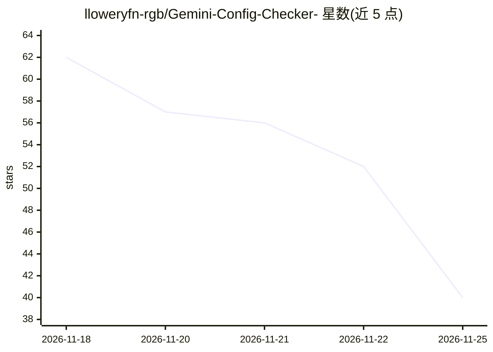

# lloweryfn-rgb/Gemini-Config-Checker-

⭐ — · [GitHub]() · 个人维护

**测试代理配置能否进入 Google AI Studio 与 Gemini 的桌面扫描工具**

以登录浏览器方式逐一测试代理配置，读取 Google 对已登录账号展示的区域判定（AI Studio 重定向或 Gemini 区域提示），而非仅做连通性探测。提供 Simple（测自有配置）与 Advanced（在基础配置后串联免费配置列表）两种模式，支持 anti-DPI 分片参数、订阅 URL/base64 输入、Xray 配置导出、批量复制与延迟排序。提供 Windows/macOS/Linux 桌面版与 Web 服务器版、Android APK（仅连通性模式）；v0.1.0 为早期预发布版。

## 筛选速览

| 维度 | 判定 | 备注 |
|---|---|---|
| AI 角色 | `ai-enhanced` | 去掉 AI 部分产品仍成立 |
| 许可风险 | `permissive` | — |
| 部署形态 | `desktop` | 安装包/桌面程序 |
| 模型依赖 | — | README 未给出锁定关系 |
| 硬件要求 | — | 无带数字的原话,不猜 |
| 安装摩擦 | `medium` | 含编译或系统依赖之一 |
| 成熟度 | `idea` | |

## 能力要点

- 以已登录浏览器读取 Google 区域判定，而非 HTTP 连通性探测
- Simple/Advanced 双模式，Advanced 可将免费配置串联在基础配置之后
- 内置可编辑的 anti-DPI 分片配置（Finalmask/指纹/ALPN/加密套件）
- 支持 vless/vmess/trojan/ss 链接、订阅 URL 与 base64 输入

## 适用场景

- 批量检验手中代理配置能否进入 AI Studio 和 Gemini
- Cloudflare 配置连通但出口被 Google 拦时，串联免费配置换出口
- 依赖某配置前先验证它当前可用

## 场景标签

 · 领域:网络工具/代理配置检测

## 证据(README 行号)

> L9: # Gemini Config Checker
> L11: Find proxy configs that actually get you into **Google AI Studio and Gemini**, by testing each one the way a person

## 星数曲线

2026-11-18 62 → 2026-11-25 40（-22）

---
*卡片 v1 · prompt 1.4 · 生成 2026-11-20 · 置信度 high · 依据 README sha `4ee11cbae78e` · [字段定义](../../DATASET.md)*
