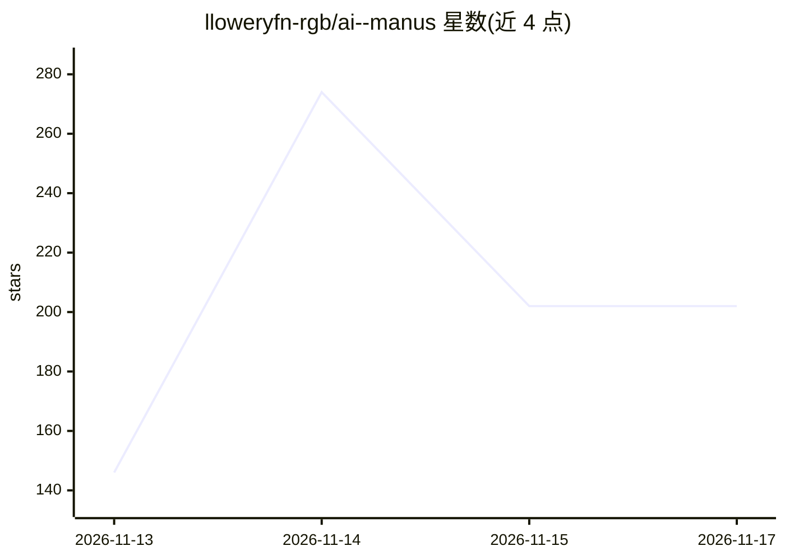

# lloweryfn-rgb/ai--manus

⭐ 202 · Apache-2.0 · 推送 2026-11-15 · [GitHub](https://github.com/lloweryfn-rgb/ai--manus) · 个人维护

**自主 AI Agent：代用户执行代码并控制浏览器完成任务**

Manus 是一个自主 AI Agent，声称可在用户授权下自行编写并执行脚本、控制浏览器（打开网页、填表、抓取信息），完成多步骤任务。定位为面向家庭、学习与轻量办公的个人助手，而非企业平台或重型工作室。README 描述了硬件兼容表（最低 4 GB 内存、双核 CPU）与六步上手流程（准备、配置、测试、细化、应用、维护），但未给出任何安装命令、源码结构或 API 接入方式，技术实现细节与实际可用形态缺乏说明。

## 筛选速览

| 维度 | 判定 | 备注 |
|---|---|---|
| AI 角色 | `ai-native` | 本体是模型或模型工具 |
| 许可风险 | `permissive` | Apache-2.0 |
| 部署形态 | `None` |  |
| 模型依赖 | — | README 未给出锁定关系 |
| 硬件要求 | — | 无带数字的原话,不猜 |
| 安装摩擦 | `low` | 无编译、无系统依赖或容器化 |
| 成熟度 | — | 结构信号不足 |

## 能力要点

- 声称支持自主执行代码完成多步任务
- 声称支持浏览器控制（导航、填表、抓取）
- 提供硬件兼容表（最低 4 GB RAM / 双核 CPU）

## 适用场景

- 让学生整理研究笔记、跑小脚本
- 让 agent 代为浏览网页、填写重复表单、汇总信息
- 把日常重复的小任务委托给后台助手

## 场景标签

`AI 助手` `浏览器自动化` · 领域:效率与自动化

## 证据(README 行号)

> L10: - **Autonomous Code Execution:** Manus AI agent runs code on its own to complete tasks, so you can focus on decisio
> L18: Manus is an autonomous AI agent designed to run code and control a browser on your behalf. Instead of acting like a
> L22: Manus is not a heavy studio suite or a complex enterprise platform. It is a focused helper built for home, study, a

## 星数曲线

2026-11-13 146 → 2026-11-17 202（+56）

---
*卡片 v1 · prompt 1.4 · 生成 2026-11-17 · 置信度 mid · 依据 README sha `fbfd5e977bf4` · [字段定义](../../DATASET.md)*
