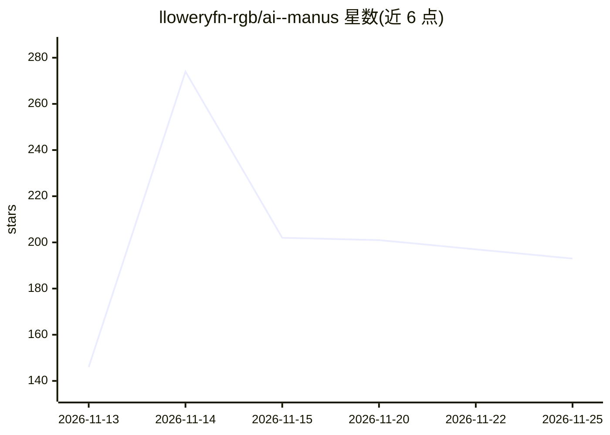

# lloweryfn-rgb/ai--manus

⭐ — · [GitHub]() · 个人维护

**面向个人用户的自主 AI Agent，代用户执行代码与浏览器操作**

README 将其描述为一个自主运行的通用 AI Agent：用户描述需求后，系统自行执行脚本、控制浏览器（打开网页、填写表单、收集信息）并完成多步任务，覆盖学习研究、家庭项目、轻量办公等小规模场景。定位为背景运行的个人助理，可跨会话记住工作模式。安装途径仅为页面上的下载入口（附促销码），未给出源码、包管理器或依赖清单；另附最低 64 位系统/双核 CPU/4GB 内存的兼容性要求。

## 筛选速览

| 维度 | 判定 | 备注 |
|---|---|---|
| AI 角色 | `ai-native` | 本体是模型或模型工具 |
| 许可风险 | `permissive` | — |
| 部署形态 | `None` |  |
| 模型依赖 | — | README 未给出锁定关系 |
| 硬件要求 | — | 无带数字的原话,不猜 |
| 安装摩擦 | `low` | 无编译、无系统依赖或容器化 |
| 成熟度 | — | 结构信号不足 |

## 能力要点

- 自主执行代码完成任务（描述需求后由 agent 生成并运行脚本）
- 浏览器控制：导航网页、填写表单、收集信息
- 跨会话记住工作模式，重复应用相同流程
- 提供最低硬件/系统兼容性要求表

## 适用场景

- 让 agent 代为整理研究笔记并运行小段脚本
- 自动从多个网页收集数据并汇总
- 把填表、检查页面等重复性小任务交给后台运行

## 场景标签

`AI 助手` `浏览器自动化` `编码 Agent` · 领域:效率与自动化

## 证据(README 行号)

> L10: - **Autonomous Code Execution:** Manus AI agent runs code on its own to complete tasks, so you can focus on decisio
> L18: Manus is an autonomous AI agent designed to run code and control a browser on your behalf. Instead of acting like a
> L41: |**Memory (RAM)**|4 GB|8 GB or more for heavy Manus autonomous tasks|

## 星数曲线

2026-11-13 146 → 2026-11-25 193（+47）

---
*卡片 v1 · prompt 1.4 · 生成 2026-11-19 · 置信度 low · 依据 README sha `c06c32a8c955` · [字段定义](../../DATASET.md)*
