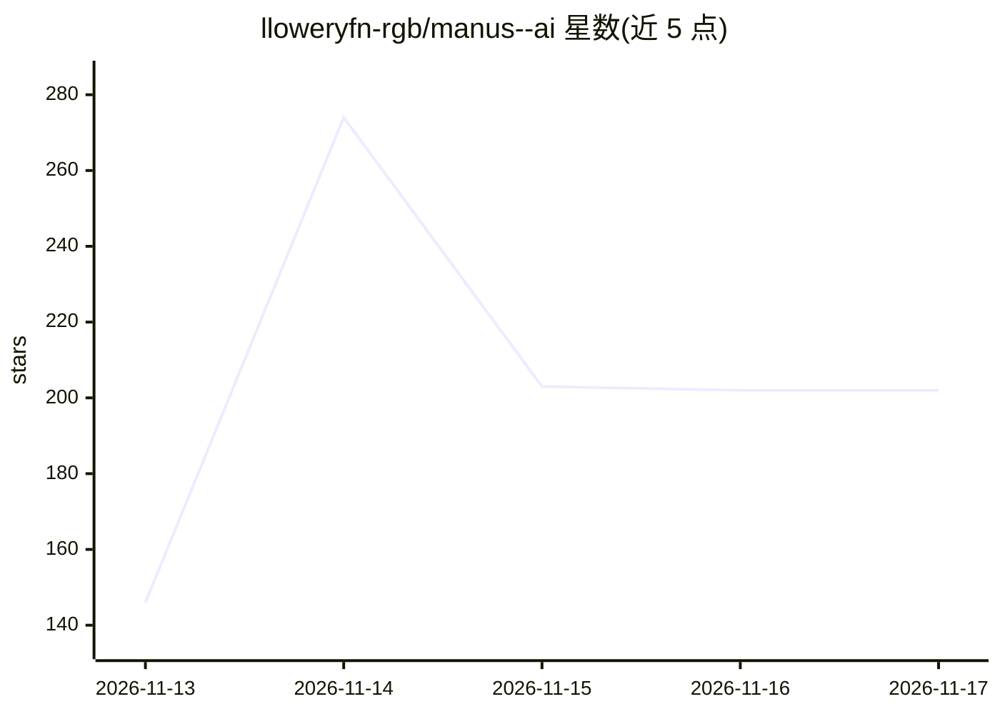

# lloweryfn-rgb/manus--ai

⭐ 202 · Apache-2.0 · 推送 2026-11-15 · [GitHub](https://github.com/lloweryfn-rgb/manus--ai) · 个人维护

**面向日常小任务的自主 AI Agent：自动写代码并操控浏览器**

README 描述 Manus 为一个自主 AI agent，代表用户编写并执行脚本、控制浏览器（导航网页、填写表单、收集信息），可执行多步骤任务，定位为家庭、学习与轻量办公场景的个人助手。声称跨会话记忆工作流模式。文档以功能宣传为主，未给出架构、模型接入方式、源码或具体安装命令，仅提供配置/测试/维护的流程性步骤与硬件兼容表（最低 4GB 内存、双核 CPU），可验证的技术细节有限。

## 筛选速览

| 维度 | 判定 | 备注 |
|---|---|---|
| AI 角色 | `ai-native` | 本体是模型或模型工具 |
| 许可风险 | `permissive` | Apache-2.0 |
| 部署形态 | `None` |  |
| 模型依赖 | — | README 未给出锁定关系 |
| 硬件要求 | — | 无带数字的原话,不猜 |
| 安装摩擦 | `low` | 无编译、无系统依赖或容器化 |
| 成熟度 | — | 结构信号不足 |

## 能力要点

- 自主编写并执行代码完成任务
- 浏览器控制：导航网页、填写表单、收集信息
- 脚本与浏览器操作在同一工作流中衔接
- 给出最低硬件兼容表（双核 CPU、4GB 内存）

## 适用场景

- 让学生整理研究资料、跑小脚本
- 代替人工在多个网页间收集数据、填表
- 远程工作者把重复性小任务委托给后台 agent

## 场景标签

`AI 助手` `编码 Agent` `浏览器自动化` · 领域:效率与自动化

## 证据(README 行号)

> L18: Manus is an autonomous AI agent designed to run code and control a browser on your behalf. Instead of acting like a
> L22: Manus is not a heavy studio suite or a complex enterprise platform. It is a focused helper built for home, study, a

## 星数曲线

2026-11-13 146 → 2026-11-17 202（+56）

---
*卡片 v1 · prompt 1.4 · 生成 2026-11-17 · 置信度 low · 依据 README sha `0f78ee3a5dd2` · [字段定义](../../DATASET.md)*
