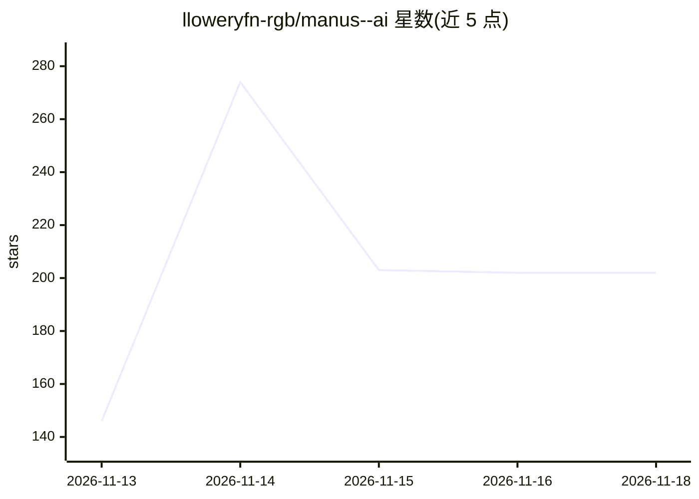

# lloweryfn-rgb/manus--ai

⭐ 202 · Apache-2.0 · 推送 2026-11-17 · [GitHub](https://github.com/lloweryfn-rgb/manus--ai) · 个人维护

**面向个人用户的自主 AI Agent：代跑代码并控制浏览器完成任务**

README 描述的 Manus 是一个自主 AI agent 应用：用户以自然语言下达指令，agent 可编写并执行脚本、打开网页并与之交互、执行多步任务，可长期在后台作为个人助手运行。定位为家庭、学习与轻度办公场景的小型助手，非企业平台。页面给出 4GB 内存起步的兼容性表，但未提供任何安装命令、源码结构或 API 接入说明，也无可验证的技术实现细节；页面顶部含下载引导与促销码。

## 筛选速览

| 维度 | 判定 | 备注 |
|---|---|---|
| AI 角色 | `ai-native` | 本体是模型或模型工具 |
| 许可风险 | `permissive` | Apache-2.0 |
| 部署形态 | `None` |  |
| 模型依赖 | — | README 未给出锁定关系 |
| 硬件要求 | — | 无带数字的原话,不猜 |
| 安装摩擦 | `low` | 无编译、无系统依赖或容器化 |
| 成熟度 | — | 结构信号不足 |

## 能力要点

- 自主执行代码与脚本完成任务
- 浏览器控制：导航、填表、采集信息
- 脚本与浏览器动作可在同一任务流中衔接
- 面向家庭、学习与轻度办公的多步任务

## 适用场景

- 让学生整理研究资料、跑小型计算脚本
- 远程工作者从多个网页收集数据
- 把重复性小任务委托给后台 agent 处理

## 场景标签

`AI 助手` `浏览器自动化` `编码 Agent` · 领域:效率与自动化

## 证据(README 行号)

> L10: - **Autonomous Code Execution:** Manus AI agent runs code on its own to complete tasks, so you can focus on decisio
> L18: Manus is an autonomous AI agent designed to run code and control a browser on your behalf. Instead of acting like a
> L22: Manus is not a heavy studio suite or a complex enterprise platform. It is a focused helper built for home, study, a

## 星数曲线

2026-11-13 146 → 2026-11-18 202（+56）

---
*卡片 v1 · prompt 1.4 · 生成 2026-11-18 · 置信度 low · 依据 README sha `c06e59c45084` · [字段定义](../../DATASET.md)*
