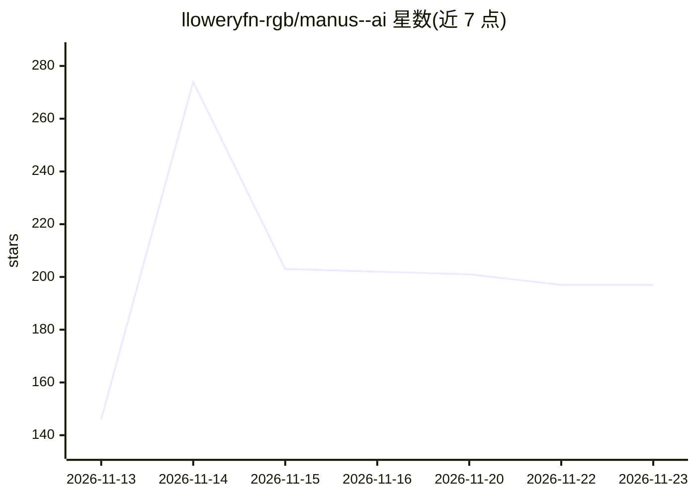

# lloweryfn-rgb/manus--ai

⭐ 197 · Apache-2.0 · 推送 2026-11-21 · [GitHub](https://github.com/lloweryfn-rgb/manus--ai) · 个人维护

**通用自主 AI Agent：代用户执行代码与浏览器操作**

面向个人与小规模任务的自主 Agent 系统：用户描述需求后，由 Agent 自主编写并执行脚本、控制浏览器完成页面导航、表单填写与信息收集，支持多步骤任务与跨会话保持工作模式。定位为轻量级个人助手，覆盖学习、家庭与轻办公场景。README 以功能介绍与使用流程为主，未给出具体安装命令、依赖或源码获取方式，兼容性部分仅列出操作系统、CPU、内存等最低配置。

## 筛选速览

| 维度 | 判定 | 备注 |
|---|---|---|
| AI 角色 | `ai-native` | 本体是模型或模型工具 |
| 许可风险 | `permissive` | Apache-2.0 |
| 部署形态 | `None` |  |
| 模型依赖 | — | README 未给出锁定关系 |
| 硬件要求 | — | 无带数字的原话,不猜 |
| 安装摩擦 | `low` | 无编译、无系统依赖或容器化 |
| 成熟度 | — | 结构信号不足 |

## 能力要点

- 自主代码执行：Agent 自行编写并运行脚本完成任务
- 浏览器控制：导航网页、填写表单、收集信息
- 多步骤自主任务与后台个人助手模式

## 适用场景

- 让 Agent 代为收集网页资料并整理笔记
- 自动化填写重复性表单等日常事务
- 快速运行小脚本做计算与测试

## 场景标签

`AI 助手` `浏览器自动化` · 领域:效率与自动化

## 证据(README 行号)

> L18: Manus is an autonomous AI agent designed to run code and control a browser on your behalf. Instead of acting like a
> L22: Manus is not a heavy studio suite or a complex enterprise platform. It is a focused helper built for home, study, a
> L40: |**Processor (CPU)**|Dual-core CPU|Modern multi-core CPU for smooth Manus code automation|

## 星数曲线

2026-11-13 146 → 2026-11-23 197（+51）

---
*卡片 v1 · prompt 1.4 · 生成 2026-11-19 · 置信度 mid · 依据 README sha `2ff41025d9ff` · [字段定义](../../DATASET.md)*
