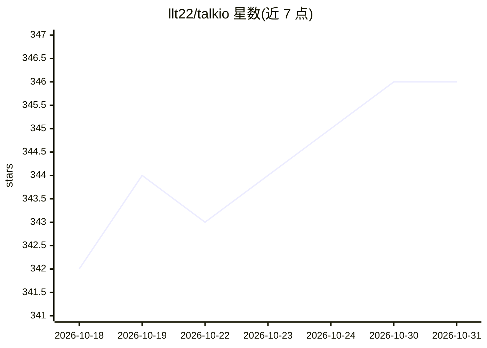

# llt22/talkio

⭐ 346 · TypeScript · MIT · 推送 2026-10-19 · [GitHub](https://github.com/llt22/talkio) · 个人维护 · 中文 README

**本地优先的多模型群聊桌面应用，多个 AI 同场对话**

基于 Tauri 2 + React 19 的桌面/移动聊天客户端：将 OpenAI、Anthropic、Gemini、DeepSeek、Ollama 等多个模型拉入同一群聊，各绑定可自定义提示词与参数的身份角色，支持 @提及、轮流发言与群组系统提示词。通过 MCP 连接本地/远程工具服务器，提供工作区文件编辑、Git 工具、文件解析、Whisper 兼容语音输入等能力。所有数据存本地 SQLite，API Key 存系统凭据库，不运行云端服务。开发运行需 Node.js 与 Rust 工具链。

## 筛选速览

| 维度 | 判定 | 备注 |
|---|---|---|
| AI 角色 | `ai-native` | 本体是模型或模型工具 |
| 许可风险 | `permissive` | MIT |
| 部署形态 | `library` | 以包/库形式分发 |
| 模型依赖 | local-ok | 支持本地模型 |
| 硬件要求 | — | 无带数字的原话,不猜 |
| 安装摩擦 | `low` | 无编译、无系统依赖或容器化 |
| 成熟度 | — | 结构信号不足 |

## 能力要点

- 多模型群聊，各参与者可绑定独立身份（Persona）与参数
- MCP 工具调用（SSE 远程 / Stdio 本地）与工作区、Git 工具
- 多 Provider 预设，覆盖 OpenAI/Anthropic/Gemini/DeepSeek/Ollama 等
- 本地优先：SQLite 存储、API Key 入系统凭据库、无云端服务

## 适用场景

- 把多个 AI 模型拉进同一个群聊对比观点或辩论
- 为 AI 配置不同身份角色完成翻译、代码审查等任务
- 通过 MCP 让 AI 调用日历、提醒及本地项目文件工具

## 场景标签

`聊天机器人` · 领域:对话与助手

## 证据(README 行号)

> L17: Talkio 不只是又一个 ChatGPT 客户端——你可以把多个 AI 模型拉进同一个群聊，让它们各自扮演不同角色，围绕同一个话题展开讨论、辩论、接龙。
> L50: 不同于传统的一对一聊天，Talkio 支持**多模型群聊**：

## 星数曲线

2026-10-18 342 → 2026-10-31 346（+4）

---
*卡片 v1 · prompt 1.4 · 生成 2026-10-21 · 置信度 high · 依据 README sha `758ba57886e3` · [字段定义](../../DATASET.md)*
