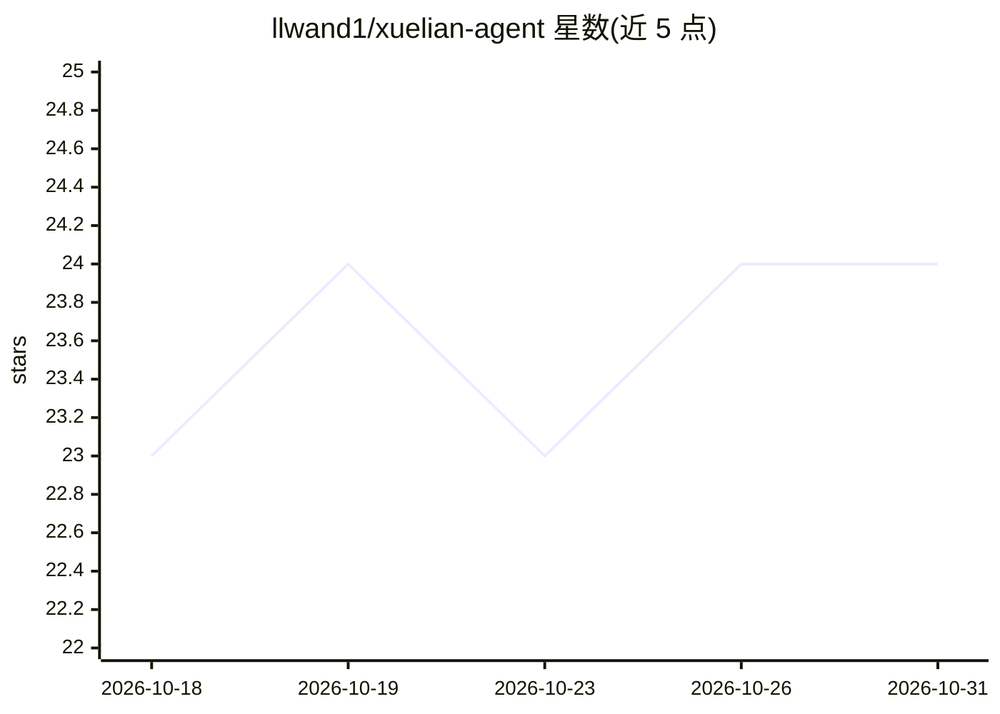

# llwand1/xuelian-agent

⭐ 24 · TypeScript · MIT · 推送 2026-10-27 · [GitHub](https://github.com/llwand1/xuelian-agent) · [官网](https://11wand.com) · 个人维护 · 中文 README

**面向自学与应试的开源 AI 学习 Agent（StudentBuddy）**

面向中文自学者、编程入门学习者与应试练习的 AI 学习应用，串联提问、资料共读、AI 出题作答、逐题解析与基于词卡/FSRS 的知识复习；资料来源可追溯，区分真实来源与 AI 生成练习。提供在线版与 Windows 本地版，学习数据留在本机，可在设置中配置自己的 AI 服务商。桌面版含悬浮球、截图提问、定时练习与浏览器共读扩展；外部 coding agent 可通过专用接口存入词条与出题预产物。README 明确声明：新的 Agent 演进与联机内核尚未接入正式主程序，公网联机等功能未交付。

## 筛选速览

| 维度 | 判定 | 备注 |
|---|---|---|
| AI 角色 | `ai-native` | 本体是模型或模型工具 |
| 许可风险 | `permissive` | MIT |
| 部署形态 | `None` |  |
| 模型依赖 | — | README 未给出锁定关系 |
| 硬件要求 | — | 无带数字的原话,不猜 |
| 安装摩擦 | `low` | 无编译、无系统依赖或容器化 |
| 成熟度 | `idea` | |

## 能力要点

- 阅读→作答→逐题解析→复习的学习闭环，答案与解题思考按题保留
- 题库搜索区分真实来源与 AI 生成练习，来源可追溯
- FSRS 复习调度（个人缩放拟合需 30 条有效复习样本）与知识大陆游戏化复习
- Windows 本地版：数据留本机、自配 AI 服务商、浏览器共读扩展与外部 agent 词条接口

## 适用场景

- 编程或 AI 入门时对照教程/仓库提问并由 AI 出题检查理解
- 应试备考圈定范围检索真题题库并逐题复盘
- 把日常学到的概念沉淀为词卡按 FSRS 计划复习
- 等 AI 回复的空档刷词卡做小复习

## 场景标签

 · 领域:教育/AI 学习

## 证据(README 行号)

> L10: **StudentBuddy：开源 AI 学习 Agent，把资料、练习、思考、反馈和复习接在一起。**
> L12: 产品本体仍叫 **StudentBuddy**，仓库名为 **xuelian-agent**。面向中文自学者、编程入门学习者与应试练习，支持 AI、Agent、JavaScript 等知识学习。从具体问题与可追溯资料开始，逐步进入
> L14: - **应试学习与题库搜索**：圈定考试范围与资源站，检索真题/题库来源，区分真实来源与 AI 生成练习；AI 可发现新资源站，经你确认后补入范围。

## 星数曲线

2026-10-18 23 → 2026-10-31 24（+1）

---
*卡片 v1 · prompt 1.4 · 生成 2026-10-27 · 置信度 high · 依据 README sha `cea02ef3bdad` · [字段定义](../../DATASET.md)*
