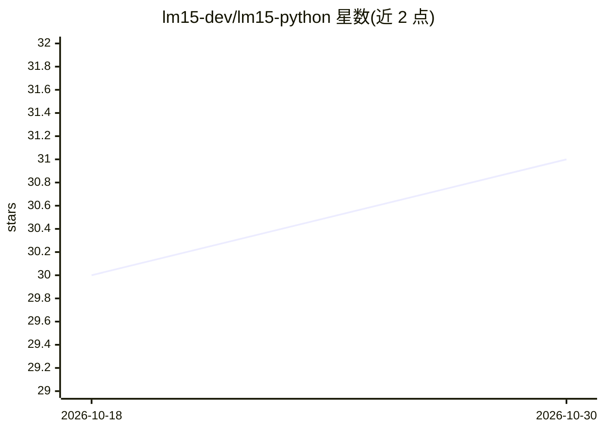

# lm15-dev/lm15-python

⭐ 31 · Python · MIT · 推送 2026-10-27 · [GitHub](https://github.com/lm15-dev/lm15-python) · [官网](https://lm15.dev) · 组织维护

**统一请求/响应模型访问各大 AI 提供商的 Python 库**

仅依赖 Python 标准库的多提供商 LLM 客户端库：定义一次 Request，通过 OpenAILM、AnthropicLM、GeminiLM 三个第一方适配器与 OpenAIChatLM 兼容方言适配器（含 ollama/groq/vllm 等 compat 预设）发送到 OpenAI、Anthropic、Gemini、xAI 及本地模型。提供类型化的流事件、函数工具完整回环、多模态输入、图像/语音生成、错误归一化与异步镜像适配器；不自动执行工具循环，面向想要自建调用层的库开发者。另支持读取 Claude Code / Codex CLI 的本地 OAuth 凭证用于本地开发。

## 筛选速览

| 维度 | 判定 | 备注 |
|---|---|---|
| AI 角色 | `ai-ecosystem` | LLM/agent 周边工具 |
| 许可风险 | `permissive` | MIT |
| 部署形态 | `library` | 以包/库形式分发 |
| 模型依赖 | local-ok | 支持本地模型 |
| 硬件要求 | — | 无带数字的原话,不猜 |
| 安装摩擦 | `low` | 无编译、无系统依赖或容器化 |
| 成熟度 | `idea` | |

## 能力要点

- 标准库实现，0 传递依赖（实时会话的 websockets 为可选）
- 同一 Request 形状覆盖第一方适配器与 OpenAI 兼容服务器（compat 预设含默认 base_url）
- 类型化流事件、跨提供商错误归一化（AuthError/RateLimitError 等）与规范化 JSON 序列化
- 可复用 Claude Code / Codex CLI 的本地登录凭证（限本地开发）

## 适用场景

- 库作者构建自己的 AI 调用层而不引入重依赖
- 同一份代码切换云端与本地（如 Ollama）模型
- 跨提供商统一处理流式输出与错误

## 场景标签

`模型网关` · 领域:Agent 开发

## 证据(README 行号)

> L3: One request and response model for every major AI model provider. Write a
> L14:  automatic tool loop, no DSL: lm15 is the dependency for libraries that

## 星数曲线

2026-10-18 30 → 2026-10-30 31（+1）

---
*卡片 v1 · prompt 1.4 · 生成 2026-10-26 · 置信度 high · 依据 README sha `52406a079e70` · [字段定义](../../DATASET.md)*
