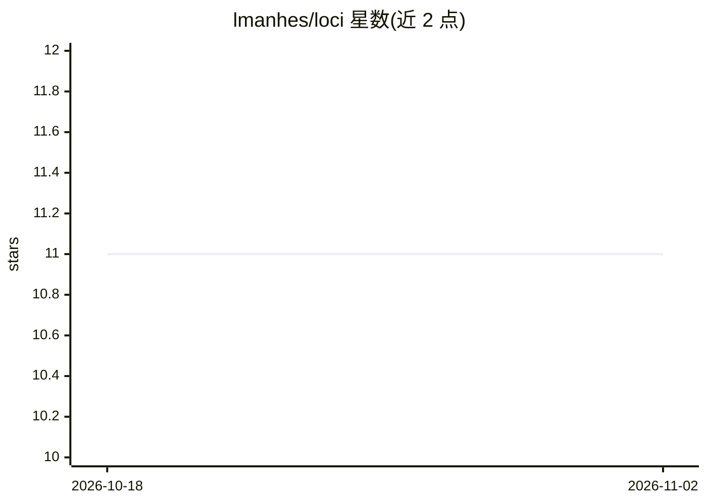

# lmanhes/loci

⭐ 11 · Python · 推送 2026-01-20 · [GitHub](https://github.com/lmanhes/loci) · [官网](https://www.antiagent.io) · 个人维护

**将文档转化为可视化知识地图并自动生成间隔重复抽认卡**

面向个人学习者的知识管理系统：导入 PDF、Markdown、手写笔记照片、音频转录等文件，用 LLM 抽取概念，经嵌入、UMAP 降维与 HDBSCAN 聚类后渲染为蜂窝状可交互知识地图。每个概念自动生成 Cloze 与问答两种抽认卡，按 FSRS 算法安排复习。支持 OpenAI 或本地 Ollama 两种模型后端，需自行从源码启动前后端服务。

## 筛选速览

| 维度 | 判定 | 备注 |
|---|---|---|
| AI 角色 | `ai-native` | 本体是模型或模型工具 |
| 许可风险 | `none` | — |
| 部署形态 | `None` |  |
| 模型依赖 | local-ok | 支持本地模型 |
| 硬件要求 | — | 无带数字的原话,不猜 |
| 安装摩擦 | `low` | 无编译、无系统依赖或容器化 |
| 成熟度 | — | 结构信号不足 |

## 能力要点

- 自动概念抽取与语义聚类的蜂窝状知识地图
- LLM 生成 Cloze/问答两种抽认卡
- FSRS 间隔重复调度复习
- 支持 OpenAI 或本地 Ollama 模型后端

## 适用场景

- 把课程讲义或笔记整理成可探索的知识地图
- 通过间隔重复抽认卡长期记忆学过的内容
- 语义搜索快速定位任意概念

## 场景标签

`知识库管理` `语义搜索` · 领域:知识与检索

## 证据(README 行号)

> L3: **Your personal knowledge map.** Loci transforms any document into a visual, explorable knowledge space with automat
> L14: - **Strengthens memory**: Generates flashcards and schedules reviews using spaced repetition (FSRS algorithm)
> L74: For each concept, the LLM generates flashcards:

## 星数曲线

2026-10-18 11 → 2026-11-02 11（+0）

---
*卡片 v1 · prompt 1.4 · 生成 2026-11-02 · 置信度 high · 依据 README sha `c4625e0af651` · [字段定义](../../DATASET.md)*
