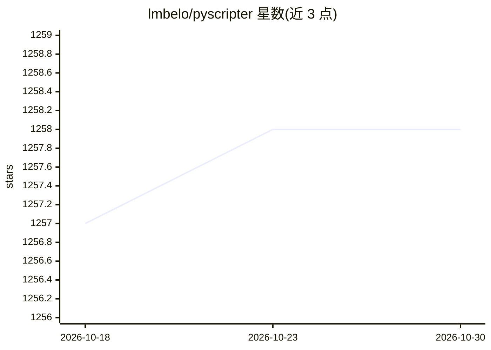

# lmbelo/pyscripter

⭐ 1,258 · Pascal · MIT · 推送 2025-11-24 · [GitHub](https://github.com/lmbelo/pyscripter) · 个人维护

**Windows 平台免费开源的 Python IDE，含 LLM 辅助编码**

面向 Windows 用户的免费开源 Python 集成开发环境，目标是与商业 Windows IDE 在功能上可比。README 以目录形式列出功能、截图、视频教程等章节，其中包含“LLM-assisted coding”（LLM 辅助编码）作为特性条目，即在编辑器中提供 AI 辅助编码功能。本体是传统 Python IDE，AI 为附加功能，去掉 AI 仍可作为 IDE 使用。许可证为 MIT，支持 PayPal 捐赠。

## 筛选速览

| 维度 | 判定 | 备注 |
|---|---|---|
| AI 角色 | `ai-enhanced` | 去掉 AI 部分产品仍成立 |
| 许可风险 | `permissive` | MIT |
| 部署形态 | `None` |  |
| 模型依赖 | — | README 未给出锁定关系 |
| 硬件要求 | — | 无带数字的原话,不猜 |
| 安装摩擦 | `low` | 无编译、无系统依赖或容器化 |
| 成熟度 | — | 结构信号不足 |

## 能力要点

- 免费开源（MIT 许可证）的 Windows Python IDE
- README 特性列表含 LLM 辅助编码（LLM-assisted coding）条目
- 提供截图、视频教程与博客等文档资源

## 适用场景

- 在 Windows 上编写与调试 Python 代码
- 使用 IDE 内置的 LLM 辅助编码功能提升编辑效率

## 场景标签

 · 领域:开发工具/IDE

## 证据(README 行号)

> L1: PyScripter is a free and open-source Python Integrated Development
> L11: * LLM-assisted coding

## 星数曲线

2026-10-18 1,257 → 2026-10-30 1,258（+1）

---
*卡片 v1 · prompt 1.4 · 生成 2026-10-21 · 置信度 mid · 依据 README sha `6227070c54bc` · [字段定义](../../DATASET.md)*
