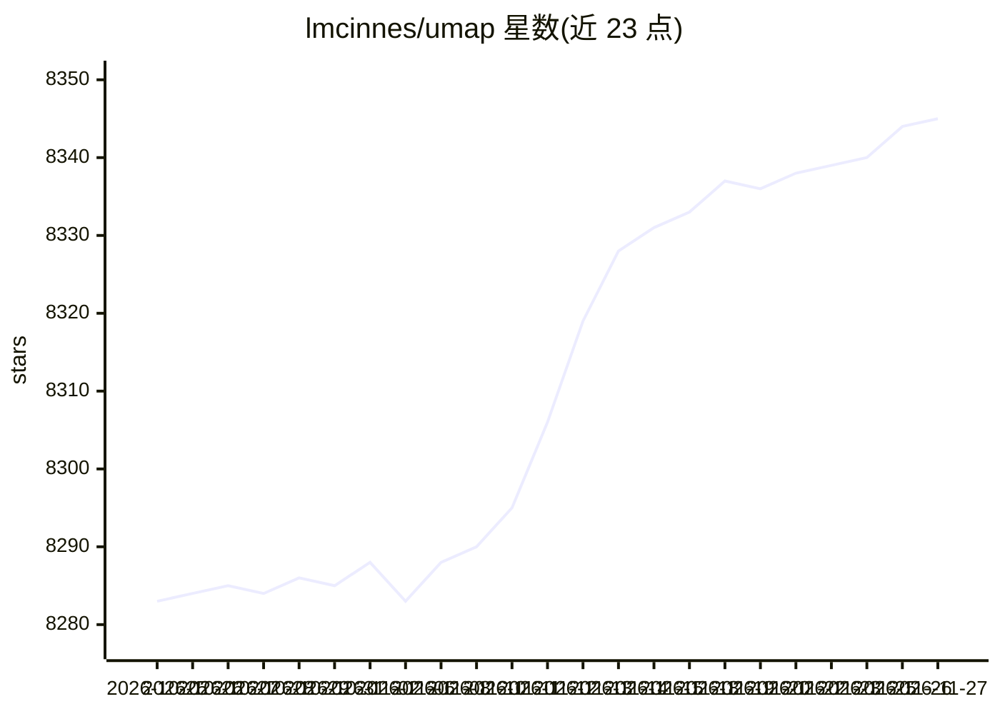

# lmcinnes/umap

⭐ 8,345 · Python · BSD-3-Clause · 推送 2026-11-24 · [GitHub](https://github.com/lmcinnes/umap) · [官网](https://umap-learn.readthedocs.io) · 个人维护

**面向数据科学者的非线性降维与可视化 Python 库**

UMAP（Uniform Manifold Approximation and Projection）是一种流形学习降维技术，基于黎曼流形的三个假设构建模糊拓扑结构，通过搜索低维投影实现嵌入。既可用于类似 t-SNE 的可视化，也可作为通用非线性降维用于其他机器学习任务的前置步骤。接口继承 sklearn 类，遵循相同的调用 API，支持稀疏矩阵、监督与半监督降维、向已有嵌入添加新点（transform）、inverse transform 及超曲空间嵌入等。支持 densMAP 保留局部密度信息；最近邻图构建依赖 pynndescent，可选 RINND 加速。Python 库形式分发于 PyPI 与 conda-forge，另附 ArXiv 与 JOSS 论文链接。

## 筛选速览

| 维度 | 判定 | 备注 |
|---|---|---|
| AI 角色 | `ai-native` | 本体是模型或模型工具 |
| 许可风险 | `permissive` | BSD-3-Clause |
| 部署形态 | `library` | 以包/库形式分发 |
| 模型依赖 | — | README 未给出锁定关系 |
| 硬件要求 | — | 无带数字的原话,不猜 |
| 安装摩擦 | `medium` | 含编译或系统依赖之一 |
| 成熟度 | — | 结构信号不足 |

## 能力要点

- 通用非线性降维，嵌入维度可扩展，不限于二维可视化
- 支持监督/半监督降维、transform 新点与 inverse transform
- 支持稀疏矩阵与多种距离度量（含 cosine、correlation）
- densMAP 与 Parametric UMAP 作为扩展功能提供

## 适用场景

- 高维数据（如单细胞转录组）的二维可视化探索
- 作为 sklearn pipeline 中的预处理降维步骤
- 降维后配合 hdbscan 做聚类
- 词向量等数据的 cosine 距离嵌入

## 场景标签

 · 领域:机器学习/数据科学工具

## 证据(README 行号)

> L45: Uniform Manifold Approximation and Projection (UMAP) is a dimension reduction
> L46: technique that can be used for visualisation similarly to t-SNE, but also for
> L201: The umap package inherits from sklearn classes, and thus drops in neatly

## 星数曲线

2026-10-25 8,283 → 2026-11-27 8,345（+62）

---
*卡片 v1 · prompt 1.4 · 生成 2026-11-22 · 置信度 high · 依据 README sha `6bbb410a3259` · [字段定义](../../DATASET.md)*
