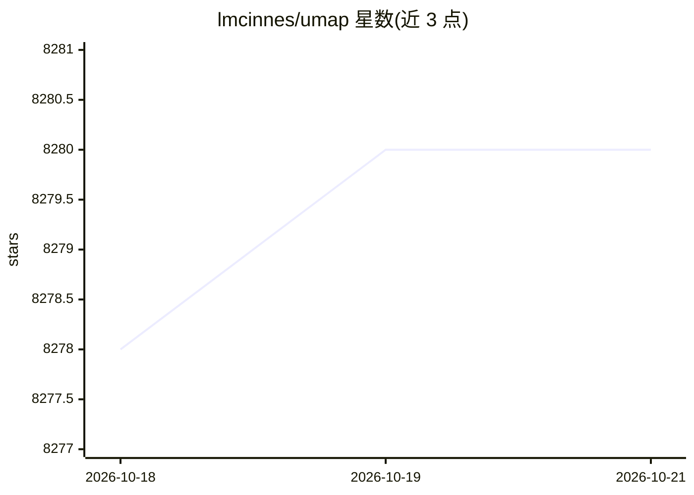

# lmcinnes/umap

⭐ 8,280 · Python · BSD-3-Clause · 推送 2026-10-16 · [GitHub](https://github.com/lmcinnes/umap) · [官网](https://umap-learn.readthedocs.io) · 个人维护

**面向数据科学家的通用非线性降维与可视化库**

UMAP 是基于流形学习与模糊拓扑结构的降维算法库，以 Python 包（umap-learn）形式提供，可用于高维数据可视化与通用非线性降维，API 与 scikit-learn transformer 一致，可作为 sklearn 流水线中的预处理步骤。支持稀疏矩阵输入、监督/半监督降维、多种距离度量（含 cosine/correlation）、transform 添加新样本，以及保留局部密度信息的 densMAP 变体。依赖 numpy/scipy/scikit-learn/numba 等；可选安装 matplotlib 等绘图依赖与 Tensorflow（Parametric UMAP）。提供 conda-forge 与 PyPI 安装，覆盖 Linux/macOS/Windows 64 位。

## 筛选速览

| 维度 | 判定 | 备注 |
|---|---|---|
| AI 角色 | `ai-native` | 本体是模型或模型工具 |
| 许可风险 | `permissive` | BSD-3-Clause |
| 部署形态 | `library` | 以包/库形式分发 |
| 模型依赖 | — | README 未给出锁定关系 |
| 硬件要求 | — | 无带数字的原话,不猜 |
| 安装摩擦 | `medium` | 含编译或系统依赖之一 |
| 成熟度 | — | 结构信号不足 |

## 能力要点

- 基于模糊拓扑结构的流形降维，兼容 sklearn API
- 支持监督/半监督降维与稀疏矩阵输入
- 提供保留局部密度的 densMAP 变体
- 支持 cosine/correlation 等非度量距离与 transform 新样本映射

## 适用场景

- 高维数据集的可视化探索
- 作为机器学习任务前的通用降维预处理步骤
- 与聚类库（hdbscan）配合做聚类分析

## 场景标签

 · 领域:机器学习/数据可视化

## 证据(README 行号)

> L45: Uniform Manifold Approximation and Projection (UMAP) is a dimension reduction
> L197:  embedding = umap.UMAP().fit_transform(digits.data)

## 星数曲线

2026-10-18 8,278 → 2026-10-21 8,280（+2）

---
*卡片 v1 · prompt 1.4 · 生成 2026-10-20 · 置信度 high · 依据 README sha `7dd14c8b6518` · [字段定义](../../DATASET.md)*
