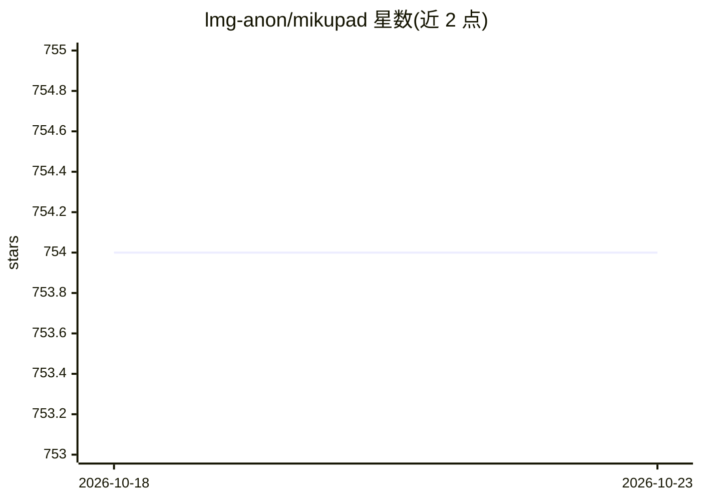

# lmg-anon/mikupad

⭐ 754 · HTML · AGPL-3.0 · 推送 2025-12-27 · [GitHub](https://github.com/lmg-anon/mikupad) · [官网](https://lmg-anon.github.io/mikupad/mikupad.html) · 个人维护

**单 HTML 文件的浏览器端 LLM 文本生成前端**

用 ReactJS 构建的浏览器界面，整个产品打包在一个 HTML 文件中，用浏览器打开即可使用，无需安装。支持 llama.cpp、koboldcpp、AI Horde 及任意 OpenAI 兼容 API 作为后端。提供会话持久化与导入导出、持久上下文（Memory/Author's Note/World Info 关键词触发注入）、预测撤销重做、token 概率悬停查看（koboldcpp 下需关闭流式）、Logit Bias 与 Completion/Chat 双模式。可选 Node.js 本地服务器实现远程数据库访问；AGPL-3.0 许可。

## 筛选速览

| 维度 | 判定 | 备注 |
|---|---|---|
| AI 角色 | `ai-ecosystem` | LLM/agent 周边工具 |
| 许可风险 | `viral` | AGPL-3.0 |
| 部署形态 | `None` |  |
| 模型依赖 | — | README 未给出锁定关系 |
| 硬件要求 | — | 无带数字的原话,不猜 |
| 安装摩擦 | `low` | 无编译、无系统依赖或容器化 |
| 成熟度 | — | 结构信号不足 |

## 能力要点

- 单 HTML 文件运行，浏览器打开即用，无需安装
- 支持 llama.cpp / koboldcpp / AI Horde / OpenAI 兼容 API 多后端
- World Info 关键词触发的动态上下文注入
- token 概率查看与从指定 token 重新生成

## 适用场景

- 在浏览器中连接本地或远程 LLM 后端进行文本生成
- 需要会话持久化与可分享导入导出的写作/角色扮演场景
- 通过 token 概率与撤销重做调试生成结果

## 场景标签

`AI 写作` · 领域:内容生成

## 证据(README 行号)

> L3: **mikupad** is a user-friendly, browser-based interface for interacting with language models. It's built with ReactJ
> L9: * **Multiple Backends**: Supports **llama.cpp**, **koboldcpp**, **AI Horde**, and any **OpenAI Compatible** API.

## 星数曲线

2026-10-18 754 → 2026-10-23 754（+0）

---
*卡片 v1 · prompt 1.4 · 生成 2026-10-21 · 置信度 high · 依据 README sha `a6143baf25bf` · [字段定义](../../DATASET.md)*
