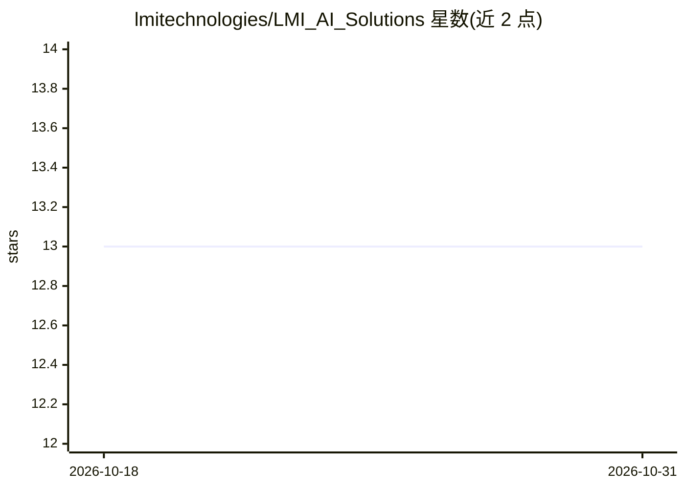

# lmitechnologies/LMI_AI_Solutions

⭐ 13 · Python · MIT · 推送 2026-10-30 · [GitHub](https://github.com/lmitechnologies/LMI_AI_Solutions) · [官网](https://lmi3d.com/factorysmart-ai-solutions-home/) · 组织维护

**LMI 公司的工业 AI 模型工具库：目标检测/异常检测/分类**

LMI Technologies 公司维护的 AI 建模开发仓库，包含工具脚本与多个子模块，支持基于 Ultralytics YOLO、YOLOv5、Detectron2、RF-DETR 的目标检测，基于 Anomalib 的异常检测，以及基于 Ultralytics YOLO 的分类任务。提供 pip 从 Git 安装与源码 editable 安装两种方式，前者面向使用者，后者面向开发者，可用 python -m 运行仓库内脚本。

## 筛选速览

| 维度 | 判定 | 备注 |
|---|---|---|
| AI 角色 | `ai-ecosystem` | LLM/agent 周边工具 |
| 许可风险 | `permissive` | MIT |
| 部署形态 | `library` | 以包/库形式分发 |
| 模型依赖 | — | README 未给出锁定关系 |
| 硬件要求 | — | 无带数字的原话,不猜 |
| 安装摩擦 | `low` | 无编译、无系统依赖或容器化 |
| 成熟度 | — | 结构信号不足 |

## 能力要点

- 支持 YOLO/YOLOv5/Detectron2/RF-DETR 目标检测
- 支持 Anomalib 异常检测与 YOLO 分类
- pip 从 Git 安装与源码 editable 安装两种途径

## 适用场景

- 工业视觉场景中训练与运行检测/异常检测模型
- 复用 LMI 提供的标注与可视化工具脚本
- 在公司内部 AI 建模流程中作为子模块集成

## 场景标签

`目标检测` · 领域:感知与多模态

## 证据(README 行号)

> L5: This repo contains the utils scripts, and several submodules for LMI Technologies Inc. AI modeling development.
> L7: Currently, the following models are supported in the repo:

## 星数曲线

2026-10-18 13 → 2026-10-31 13（+0）

---
*卡片 v1 · prompt 1.4 · 生成 2026-10-31 · 置信度 high · 依据 README sha `bcc1bae1188e` · [字段定义](../../DATASET.md)*
