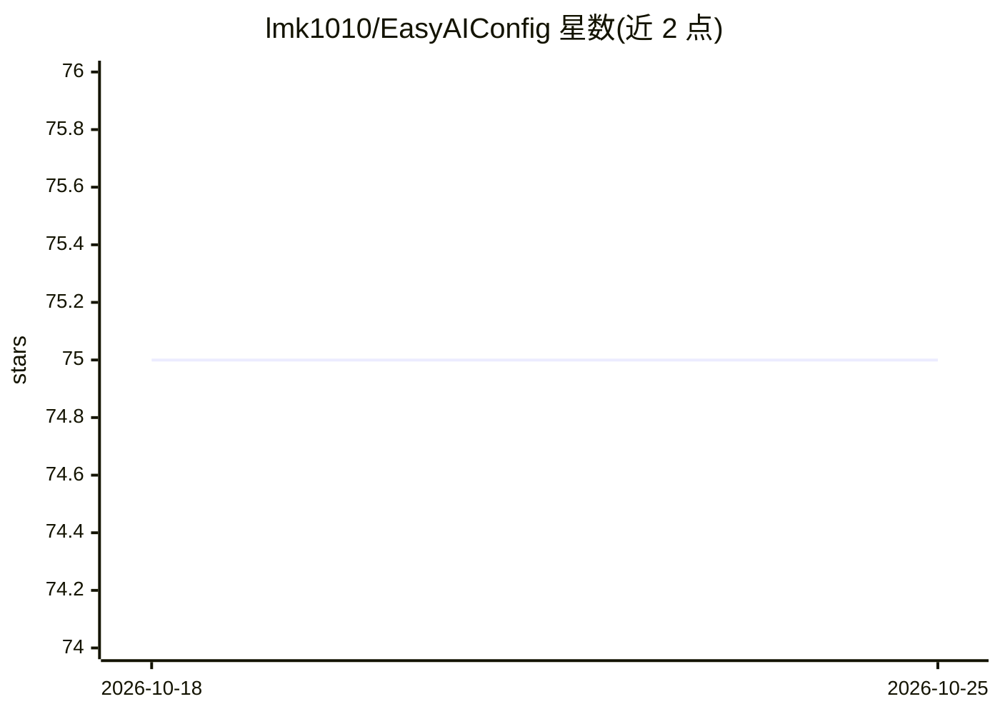

# lmk1010/EasyAIConfig

⭐ 74 · JavaScript · MIT · 推送 2026-07-31 · [GitHub](https://github.com/lmk1010/EasyAIConfig) · 个人维护 · 中文 README

**本地桌面应用：集中配置与管理 AI 编程工具的 Provider、密钥与用量**

把 Codex、Claude Code、OpenCode、OpenClaw、Gemini CLI 等工具的配置集中到一个本地优先的桌面应用：管理 Provider 与 API Key/OAuth 账号、自动拉取模型列表、读取本地日志汇总用量与费用、内置本地反代网关统一入口、管理工具安装，并提供 Flutter 手机 App 扫码配对远程新建/审批/镜像会话。默认只在本地读写配置文件，不上传密钥。提供 macOS/Windows/Linux 安装包、Android APK 与 npm Web 模式。

## 筛选速览

| 维度 | 判定 | 备注 |
|---|---|---|
| AI 角色 | `ai-ecosystem` | LLM/agent 周边工具 |
| 许可风险 | `permissive` | MIT |
| 部署形态 | `desktop` | 安装包/桌面程序 |
| 模型依赖 | — | README 未给出锁定关系 |
| 硬件要求 | — | 无带数字的原话,不猜 |
| 安装摩擦 | `low` | 无编译、无系统依赖或容器化 |
| 成熟度 | — | 结构信号不足 |

## 能力要点

- Provider / OAuth / API Key 集中管理与本地 Router 支持
- 本地反代网关：请求日志、搜索、分页与保留策略
- 读取本地日志/JSONL/SQLite 汇总用量、费用与模型分布
- Flutter 手机 App 扫码配对，远程新建/审批/镜像 Codex 与 Claude Code 会话

## 适用场景

- 我管理多个 AI 编程工具的 Provider 和 API Key，不想手写配置文件
- 我想在一个界面查看各工具的用量和费用
- 我想用手机远程操控电脑上的 Codex / Claude Code 会话

## 场景标签

`模型网关` · 领域:Agent 开发

## 证据(README 行号)

> L7:  管理 Provider、模型、OAuth / API Key、用量、终端启动、反代网关和常用工具安装。
> L15: EasyAIConfig 用来把 Codex、Claude Code、OpenCode、OpenClaw、Gemini CLI、Hermes Agent、Claude Desktop 等工具的配置集中到一个本地桌面应用里。
> L35: |工具安装|管理 Codex、Claude Code、OpenCode、OpenClaw、IDE 插件和桌面应用|

## 星数曲线

2026-10-18 75 → 2026-10-25 75（+0）

---
*卡片 v1 · prompt 1.4 · 生成 2026-10-24 · 置信度 high · 依据 README sha `0a7e3e799bdf` · [字段定义](../../DATASET.md)*
