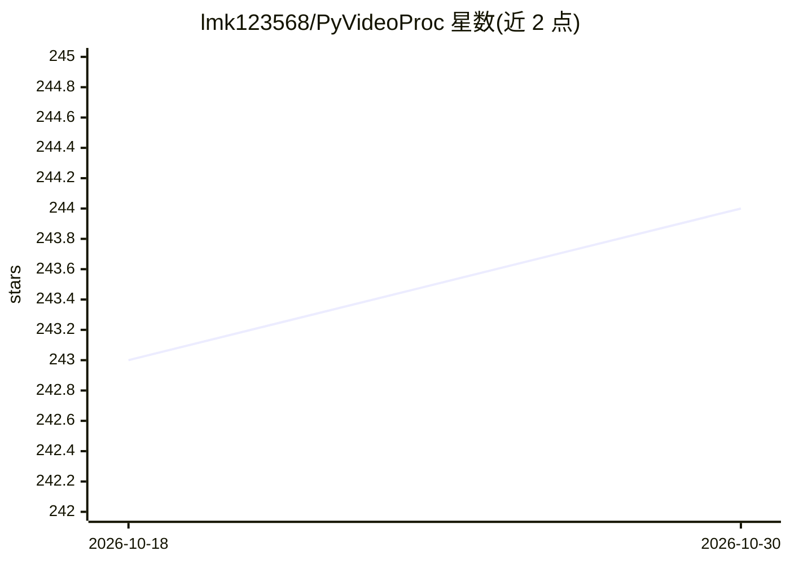

# lmk123568/PyVideoProc

⭐ 244 · C++ · BSD-2-Clause · 推送 2026-10-29 · [GitHub](https://github.com/lmk123568/PyVideoProc) · 个人维护 · 中文 README

**Python 多路视频流解码-推理-跟踪的 CUDA 框架**

基于 CUDA 的视频流处理框架：在 Python 中实现多路、多卡、多模型的视频解码、推理（YOLO26/TensorRT）、跟踪与分析。机制上采用多进程绕过 GIL、减少 Host-Device 数据传输、尽可能在 GPU 上计算；提供 C++ 加速包（硬件编解码、YOLO26 推理优化）经 Pybind11 暴露给 Python。推荐以 Docker 容器运行，需 NVIDIA 驱动与 Container Toolkit；附 pt→TensorRT 权重转换脚本与基准测试。

## 筛选速览

| 维度 | 判定 | 备注 |
|---|---|---|
| AI 角色 | `ai-ecosystem` | LLM/agent 周边工具 |
| 许可风险 | `permissive` | BSD-2-Clause |
| 部署形态 | `self-host` | docker 或自建部署 |
| 模型依赖 | — | README 未给出锁定关系 |
| 硬件要求 | — | 无带数字的原话,不猜 |
| 安装摩擦 | `low` | 无编译、无系统依赖或容器化 |
| 成熟度 | — | 结构信号不足 |

## 能力要点

- 多路/多卡/多模型视频流解码-推理-跟踪
- C++ 加速包（硬件编解码、YOLO26 TensorRT 优化）经 Pybind11 供 Python 调用
- pt2trt.py 权重转换并与 ultralytics 官方结果对齐
- 多进程绕过 GIL，减少 Host-Device 传输

## 适用场景

- 在多路 RTSP 流上跑 YOLO 检测并输出 RTMP
- 中小型视频分析项目快速部署
- 需要多 GPU 多模型组合的视频推理管线

## 场景标签

`目标检测` `推理引擎` · 领域:感知与多模态

## 证据(README 行号)

> L5: 用 Python 在 CUDA 上高效实现多路、多卡、多模型的视频流解码推理跟踪分析，并显著降低开发复杂度
> L67: 这里面包含了硬件编解码、YOLO26 推理优化的 C++ 实现，并通过 Pybind11 给 Python 调用

## 星数曲线

2026-10-18 243 → 2026-10-30 244（+1）

---
*卡片 v1 · prompt 1.4 · 生成 2026-10-22 · 置信度 high · 依据 README sha `bfdd07fbe2f8` · [字段定义](../../DATASET.md)*
